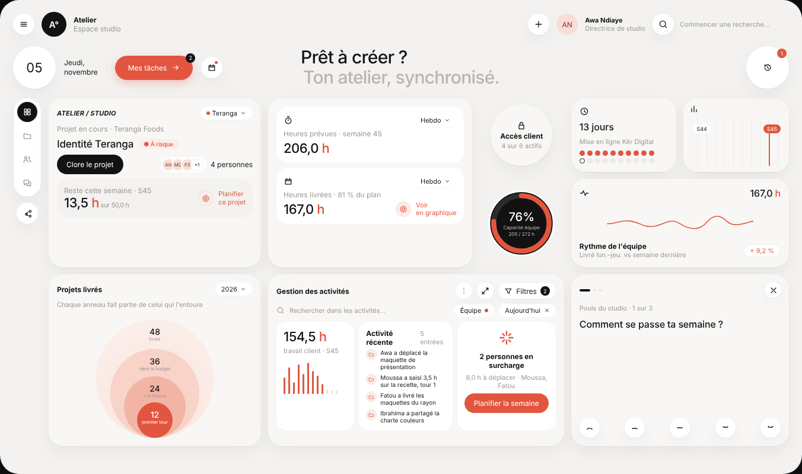
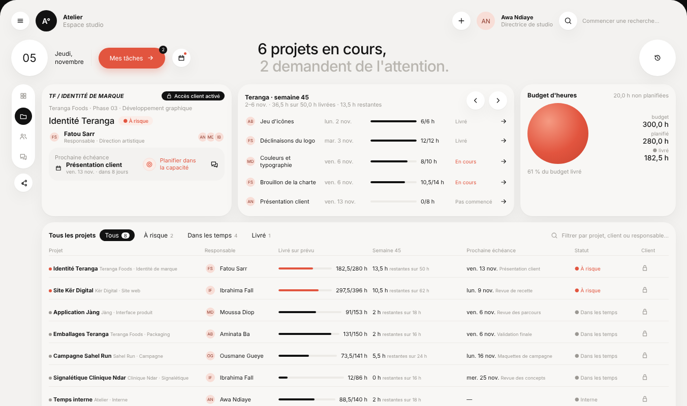
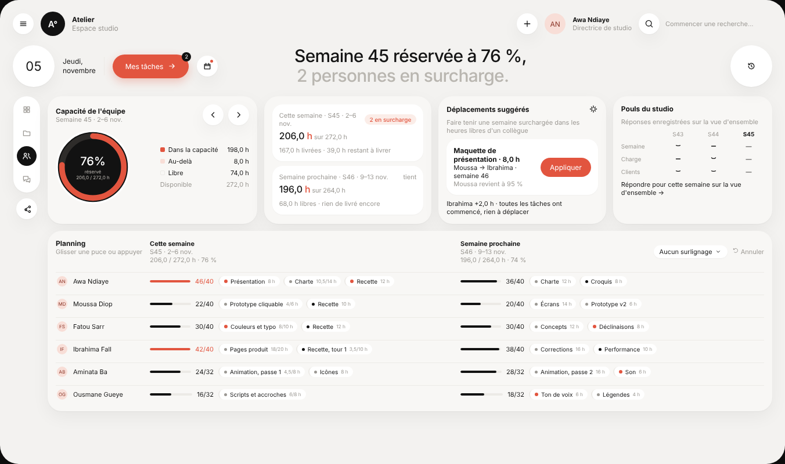
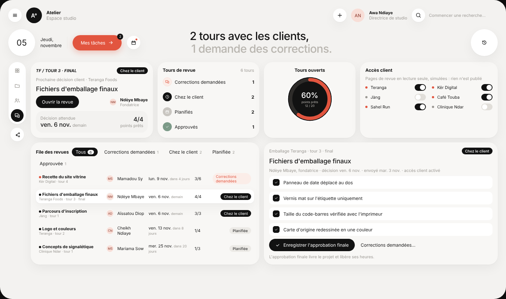

# Modèle 01 — Tableau de bord « Atelier »

Tableau de bord clair d'un studio (projets, équipe, revues clients), en grille de cartes très arrondies, avec un seul accent corail, des jauges sur **disque noir** et une **phrase d'accueil qui change selon la vue**. Quatre vues reliées par un rail d'icônes. Reconstruction originale d'après une démo publique de tableau de bord d'agence : nom, données et code réécrits ; structure, proportions et timings relevés image par image.

| Projets | Capacité de l'équipe | Revues clients |
|---|---|---|
|  |  |  |

## Quand le choisir

- Pilotage d'une équipe ou d'une activité : charge de travail, projets, revues clients, échéances.
- SaaS B2B où l'utilisateur ouvre l'écran plusieurs fois par jour et veut **une phrase** qui résume la situation avant les chiffres.
- Écrans de 1280 px et plus. Sur mobile : empiler les cartes dans l'ordre de lecture, garder la phrase d'accueil en tête, remplacer le rail par une barre d'onglets en bas.

À éviter pour : back-office dense de saisie, interface sombre imposée par la marque, données qui changent à la seconde.

## Relevé élément par élément

Chaque élément ci-dessous figure dans la vidéo de référence et dans `exemple.tsx`. En adaptant, retirer un élément est un choix conscient, pas un oubli.

### Coquille (commune aux quatre vues)

| Zone | Éléments |
|---|---|
| En-tête gauche | bouton rond menu · logo rond noir (initiale + °) · nom de l'espace + sous-titre gris |
| En-tête droite | bouton rond « + » · avatar rond corail pâle (initiales) + nom + rôle · bouton rond loupe + texte gris « Commencer une recherche… » |
| Bandeau | jour dans un cercle blanc de 72 px · « Jeudi, novembre » sur deux lignes, séparé par un trait vertical · bouton pilule corail « Mes tâches → » avec badge noir · bouton rond calendrier avec point corail · phrase d'accueil sur deux lignes (noire puis grise, curseur clignotant devant la ligne 2) · grand bouton rond historique de 72 px, à l'extrême droite, badge corail sur la vue d'ensemble |
| Rail | pilule blanche verticale, 4 icônes (grille, dossier, équipe, bulles), l'active sur disque noir qui glisse · bouton rond « partager » séparé, en dessous |
| Toast | pilule noire en bas au centre : icône corail cochée · titre + détail gris · bouton « ↶ Annuler » · croix |

### Vue d'ensemble

| Carte | Éléments |
|---|---|
| Projet en cours | surtitre italique majuscule · sélecteur pilule (point corail + nom) · « Projet en cours · client » · titre + pastille « ● À risque » · bouton noir « Clore le projet » · avatars empilés + « +1 » + « 4 personnes » · sous-carte grise « Reste cette semaine · S45 / 13,5 h sur 50,0 h » + action corail « Planifier ce projet » |
| Heures | deux sous-cartes blanches empilées, chacune : icône (chrono / calendrier) + sélecteur « Hebdo », libellé, valeur en heures ; la seconde ajoute l'action corail « Voir en graphique » |
| Accès client | petite carte **ronde** : cadenas, « Accès client », « 4 sur 6 actifs » |
| Jauge | disque noir sans carte : piste anthracite, arc corail, « 76 % / Capacité équipe / 206 / 272 h » en blanc |
| Échéance | icône horloge · « 13 jours » · libellé · 20 points (10 pleins corail, 1 cerclé noir = aujourd'hui, 9 vides) |
| Semaines | icône barres · fond rayé de traits verticaux · étiquettes S44 (blanche) et S45 (corail) · trait vertical corail sous S45 |
| Rythme | icône pouls · valeur « 167,0 h » à droite · courbe corail fine · titre + sous-titre · badge contour « + 9,2 % » |
| Projets livrés | titre + sélecteur d'année · sous-titre · 4 disques concentriques alignés en bas, du plus pâle au corail plein (48 livrés, 36 dans le budget, 24 à l'heure, 12 premier tour) |
| Gestion des activités | titre · boutons ronds « ⋮ » et « agrandir » · pilule « Filtres » + compteur noir · recherche · puces « Équipe ● » et « Aujourd'hui × » · 3 sous-cartes : heures + bâtons corail (les derniers pâles) ; activité récente (5 entrées, icônes corail) ; alerte (étincelle corail, « 2 personnes en surcharge », bouton corail « Planifier la semaine ») |
| Pouls du studio | indicateur de pages (pilule noire + 2 points) · croix · « Pouls du studio · 1 sur 3 » · question · 5 boutons ronds d'humeur |

### Projets

| Carte | Éléments |
|---|---|
| Projet | surtitre · pastille noire « Accès client activé » avec cadenas · client · phase · titre + pastille de risque · responsable (avatar, nom, rôle) + avatars d'équipe · sous-carte « Prochaine échéance » (icône calendrier, titre, date relative) + action corail + icône bulles |
| Livrables de la semaine | titre + résumé chiffré · flèches rondes · lignes : avatar, livrable, date, barre de progression, « fait/prévu h », état (Livré gris, En cours corail, Pas commencé gris), flèche |
| Budget d'heures | « 20,0 h non planifiées » · **sphère corail** en dégradé radial · colonne budget / planifié / livré · « 61 % du budget livré » |
| Tous les projets | onglets avec compteurs (actif en pilule noire) · recherche · tableau : projet (point + nom + client · type), responsable, barre livré/prévu (corail si à risque), semaine, échéance, statut, cadenas client |

### Capacité de l'équipe

| Carte | Éléments |
|---|---|
| Capacité | titre + semaine · flèches rondes · grande jauge noire « 76 % réservé » · légende : dans la capacité (carré corail), au-delà (corail pâle), libre (vide), disponible (gris) |
| Semaines | deux sous-cartes blanches : semaine, pastille « 2 en surcharge » ou « tient », heures sur capacité, barre corail, ligne de détail |
| Déplacements suggérés | icône étincelle · explication · sous-carte avec la proposition (tâche, de → vers, effet) et bouton corail « Appliquer » · ligne de constat |
| Pouls du studio | tableau Semaine / Charge / Clients × S43 / S44 / S45 avec glyphes d'humeur · lien « Répondre… → » |
| Planning | en-tête trois colonnes (titre, cette semaine, semaine prochaine) · sélecteur « Aucun surlignage » · « ↶ Annuler » · une ligne par personne : avatar, nom, puis pour chaque semaine barre + « h/max » (corail si dépassement) et puces de tâches **déplaçables** (point coloré, titre, durée) |

### Revues clients

| Carte | Éléments |
|---|---|
| Revue en cours | surtitre · pastille noire « Chez le client » · décision attendue · titre · bouton noir « Ouvrir la revue » · contact (avatar, nom, rôle) · sous-carte « Décision attendue » + « 4/4 points prêts » |
| Tours de revue | 4 lignes avec pastille ronde d'état (corail, noir, gris, vert-gris) et compteur |
| Tours ouverts | jauge noire « 60 % points prêts 12 / 20 » |
| Accès client | explication · grille 2 colonnes d'interrupteurs noirs (point corail si actif) |
| File des revues | onglets avec compteurs · lignes : point, titre + client, contact, date + délai relatif, points, statut (corail pâle, pilule noire, pilule grise) ; ligne choisie sur fond blanc |
| Détail de la revue | contexte · pastille · titre · ligne de métadonnées · 4 cases noires cochables sur fond blanc · bouton noir « Enregistrer l'approbation finale » + bouton texte « Corrections demandées… » · note |

## Fichiers

| Fichier | Contenu |
|---|---|
| `exemple.tsx` | Composant React complet (`motion` uniquement), quatre vues, icônes en SVG, données fictives |
| `style.md` | Tokens de couleur, rayons, ombres, typographie, espacements |
| `animations.md` | Chaque animation : déclencheur, propriétés, durée, courbe, décalage |
| `apercu.png`, `projets.png`, `capacite.png`, `revues.png` | Rendu du composant |

## Adapter

- **Remplacer les données et les phrases d'accueil** : chaque vue a *son* fait principal.
- **Changer l'accent** selon la marque (une teinte + sa version douce et pâle). Vérifier le contraste du texte blanc sur l'accent (≥ 4,5:1).
- **Garder** : la coquille, les jauges sur disque noir, la hiérarchie phrase → chiffres → détails, les durées d'animation.
- **Retirer** ce qui n'a pas de donnée réelle derrière : une jauge sans mesure ou une courbe décorative trahissent un tableau de bord générique.
