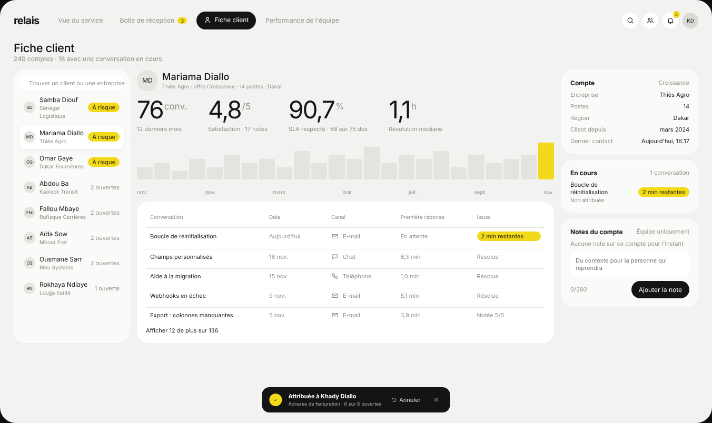
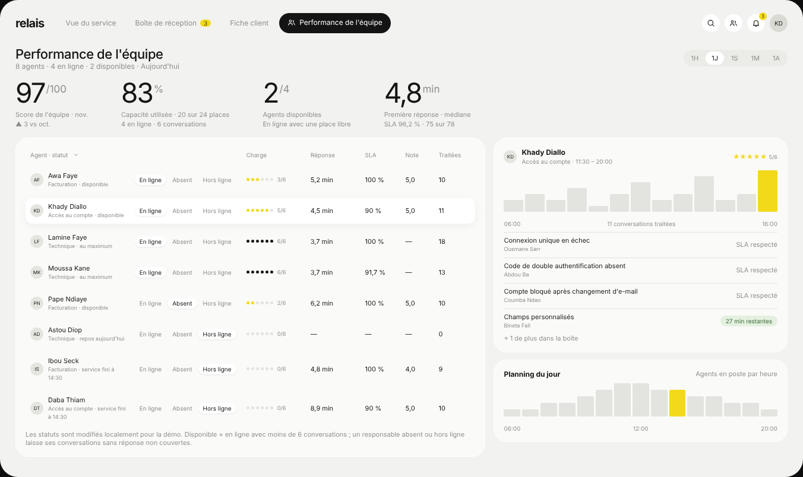

# Modèle 02 — Tableau de bord de support « Relais »

Tableau de bord de service client très aéré : **indicateurs géants à exposant**, un **graphique pleine largeur** révélé de gauche à droite sur un fond hachuré, un seul accent jaune vif employé comme **surligneur**. Quatre vues reliées par des onglets en pilule. Reconstruction originale d'après une démo publique de tableau de bord de support : nom, données et code réécrits ; structure, proportions et timings relevés image par image.

| Boîte de réception | Fiche client | Performance de l'équipe |
|---|---|---|
|  |  |  |

## Quand le choisir

- Suivi d'un service avec **délais à tenir** : support client, réclamations, demandes d'intervention, tickets.
- Écran où **un indicateur temporel** (délai de réponse, file d'attente, ventes de la journée) mérite toute la largeur.
- Boîte de réception où l'urgence doit sauter aux yeux sans rouge : la pastille jaune « 2 min restantes » suffit.

À éviter pour : données financières où le jaune fluo paraît léger (passer l'accent en vert ou bleu), plus de quatre indicateurs en tête.

## Relevé élément par élément

### Coquille

| Zone | Éléments |
|---|---|
| Barre haute | marque en minuscules · onglets texte gris ; l'actif en pilule noire avec son icône, qui glisse d'un onglet à l'autre · compteur jaune sur « Boîte de réception » · à droite : boutons ronds blancs loupe, équipe, cloche (badge jaune) · avatar gris |
| Titre de vue | titre 22 px + sous-titre chiffré gris · à droite selon la vue : sélecteur de période 1H/1J/1S/1M/1A ou tri Attention/Échéance/Plus récentes |
| Toast | pilule noire en bas au centre : rond jaune coché · « Attribuée à … » + détail gris · « ↶ Annuler » · croix |

### Vue du service

| Élément | Détail |
|---|---|
| Indicateurs | 3 valeurs de 46 px à exposant gris (« min », « % », « /5 ») sans carte, libellé de méthode, évolution « ▲ … vs hier » |
| Pastille de gain | bloc gris arrondi : rond blanc flèche montante + surligné « +2,7 pts » · taux de résolution du jour · « 70,2 % · 59 sur 84 » |
| Mise à jour | « Mis à jour : » + puce grise avec heure et date, alignée à droite |
| Bascule de série | « Délai de réponse » + P25 / Médiane / P75, l'active surlignée en jaune ; la courbe se redessine |
| Graphique | fond de hachures verticales grises · graduations « 10 min » et « 5 » à gauche · courbe jaune lisse · bande de hachures jaunes sur la tranche survolée · repère vertical pointillé noir · bulle blanche (heure, valeur, série) · axe horaire, l'heure survolée en gras |
| Conversations | titre + flèche · sous-titre · « 1 280 / Demandes clients » · barres en pointillés jaunes qui montent, étiquette jaune « Aujourd'hui +84 » au-dessus · surligné « 98 % résolues » + « 1 255 sur 1 280 » |
| En cours | même gabarit : « 25 / Conversations ouvertes », étiquette « 3 nouvelles », surligné « ● 3 à risque », « ▲ 2 agents disponibles » |
| Score de l'équipe | sélecteur « Ce mois » · sous-titre · carrousel de trois scores (voisins réduits et pâlis) avec triangle noir au-dessus de l'actif · « 2e meilleur score… » · graduations jaunes |
| Notes de l'équipe | bouton rond « + » · date de mise à jour · notes : avatar, nom, heure, texte, séparées par un filet |

### Boîte de réception

| Élément | Détail |
|---|---|
| Onglets de liste | En cours 25 · À risque (compteur jaune) · Non attribuées · Ce mois ; l'actif en pilule blanche · champ « Filtrer par sujet, client, n° C… » |
| Tableau | point d'état (jaune urgent, jaune pâle proche, gris), sujet gras + « réf · priorité · heure », client (avatar, nom, entreprise), canal (icône + texte), responsable (avatar + prénom, « · absent » ou « Non attribuée »), première réponse (pilule jaune ≤ 20 min, verte ≤ 30 min, grise au-delà, ou « SLA respecté » en texte) · ligne choisie sur fond blanc ombré · pied « 25 conversations » + mention de démo |
| Panneau de détail | ligne de contexte (icône canal, réf, canal, priorité, heure) · titre · contact + « Fiche client » · bloc compte à rebours (anneau qui tourne, « N min restantes », échéance et objectif, pilule verte « Couvert · X est en ligne ») · responsable + « Réattribuer », ou « Non attribuée » + bouton noir « Attribuer » · « Contexte client » + ville · 6 tuiles grises (offre, 12 mois, satisfaction, SLA, ouvertes, client depuis) · bascule « Brouillon de réponse / Note interne » + « Jamais envoyé » · zone de texte · mention + bouton noir « Enregistrer le brouillon » |

### Fiche client

| Élément | Détail |
|---|---|
| Liste | champ de recherche · lignes : avatar, nom, entreprise, surligné « À risque » ou « N ouvertes » · ligne choisie sur fond blanc |
| En-tête client | grand avatar · nom 18 px · entreprise, offre, postes, ville |
| Indicateurs | 4 valeurs à exposant (conv., /5, %, h) |
| Histogramme annuel | barres grises, la dernière jaune, axe des mois |
| Historique | carte blanche : conversation, date, canal (icône), première réponse, issue (surligné si en cours) · « Afficher 12 de plus sur 136 » |
| Colonne droite | Compte (offre en gris, 5 lignes clé/valeur) · En cours (conversation + surligné) · Notes du compte (« Équipe uniquement », zone de texte, compteur 0/280, bouton noir « Ajouter la note ») |

### Performance de l'équipe

| Élément | Détail |
|---|---|
| Indicateurs | 4 valeurs à exposant (/100, %, /4, min) avec deux lignes de légende |
| Tableau des agents | avatar, nom, rôle · disponibilité · sélecteur de statut En ligne / Absent / Hors ligne (pastille blanche qui glisse) · charge en 6 points (jaunes, noirs si complet) + « n/6 » · réponse, SLA, note, traitées · ligne choisie blanche · note explicative |
| Agent choisi | avatar, nom, rôle et horaires · étoiles jaunes « 5/6 » · histogramme horaire gris, la dernière heure jaune · axe + « 11 conversations traitées » · ses conversations avec « SLA respecté » ou pilule verte · « + 1 de plus dans la boîte » |
| Planning du jour | « Agents en poste par heure » · histogramme gris, l'heure courante en jaune · axe 06:00 / 12:00 / 20:00 |

## Fichiers

| Fichier | Contenu |
|---|---|
| `exemple.tsx` | Composant React (`motion` uniquement), quatre vues, icônes en SVG, données fictives |
| `style.md` | Tokens |
| `animations.md` | Révélation du graphique, cascade, carrousel, onglet actif, statuts, compte à rebours |
| `apercu.png`, `boite.png`, `client.png`, `equipe.png` | Rendu du composant |

## Adapter

- Garder **trois ou quatre** indicateurs en tête, choisis parmi ceux que l'équipe suit vraiment ; les libellés disent la méthode (« médiane », « 75 sur 78 »).
- La courbe trace **une seule série** ; une comparaison se met en pointillé gris, pas en seconde couleur.
- Jaune → autre accent : garder un accent clair et lumineux et un texte d'accent foncé (`--accent-texte`) ; vérifier le contraste (≥ 4,5:1).
- Sur mobile : indicateurs en défilement horizontal, graphique pleine largeur, liste sans colonnes client et canal, panneau de détail en plein écran.
