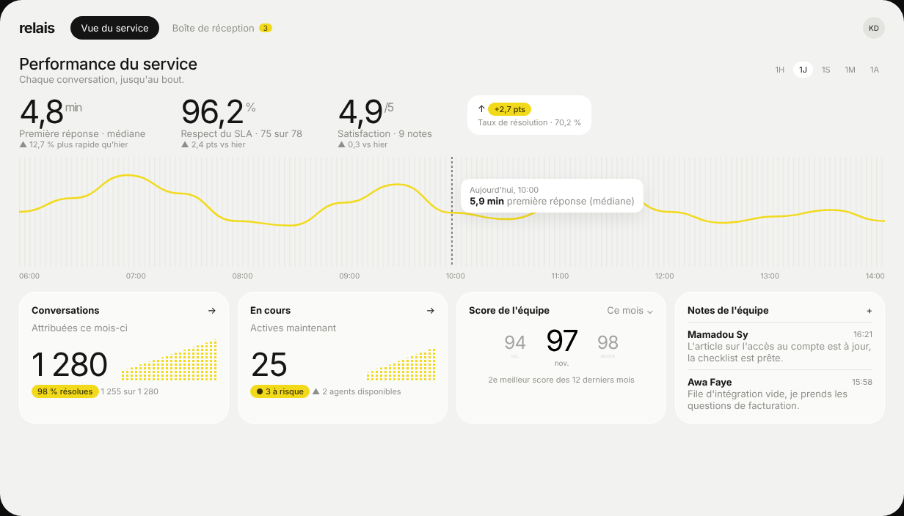
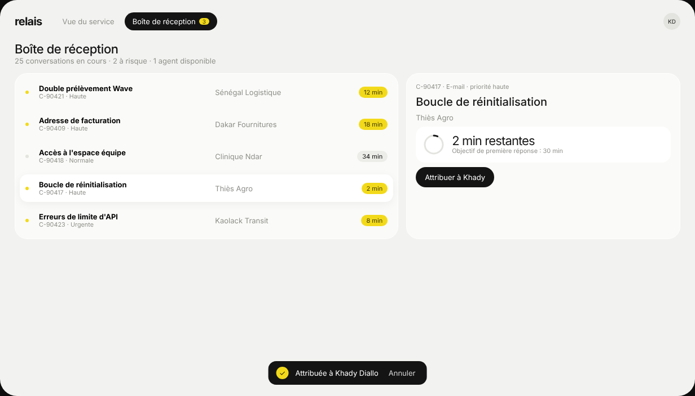

# Modèle 02 — Tableau de bord de support « Relais »



Tableau de bord de service client très aéré : **trois gros indicateurs à exposant** (« 4,8 min », « 96,2 % », « 4,9 /5 »), un **graphique pleine largeur** révélé de gauche à droite sur un fond hachuré, puis des cartes basses. Un seul accent jaune vif sert de surligneur. Deuxième vue : boîte de réception avec délais SLA et panneau de détail. Reconstruction originale d'après une démo publique de tableau de bord de support : nom, données et code réécrits.



## Quand le choisir

- Suivi d'un service avec **délais à tenir** : support client, réclamations, demandes d'intervention, tickets.
- Écran où **un indicateur temporel** (délai de réponse, file d'attente, ventes de la journée) mérite toute la largeur.
- Boîte de réception où l'urgence doit sauter aux yeux sans rouge : la pastille jaune « 2 min » suffit.

À éviter pour : données financières sérieuses où le jaune fluo paraît léger (passer l'accent en vert ou bleu), plus de quatre indicateurs en tête (ils perdent leur taille).

## Structure

```
Barre haute    marque en minuscules · onglets en pilule (actif noir, compteur jaune) ······ avatar
Vue service    titre + sous-titre ······································ sélecteur 1H/1J/1S/1M/1A
               3 indicateurs géants à exposant · pastille de gain (+2,7 pts)
               graphique pleine largeur : fond hachuré, courbe jaune, repère pointillé + bulle
               4 cartes : conversations (barres en pointillés) · en cours · score (carrousel) · notes
Vue boîte      titre + résumé chiffré
               liste (point d'état, sujet + référence, client, délai en pastille) | panneau de détail
               (compte à rebours circulaire, action principale) · toast « Attribuée… Annuler »
```

## Ce qui fait l'effet

1. **Le chiffre d'abord** : 44 px, graisse 400, chasse très serrée, l'unité en exposant gris. Pas de carte autour des indicateurs.
2. **L'accent sert de surligneur** (fond jaune, texte presque noir), jamais de texte jaune sur fond clair.
3. **Le fond hachuré** du graphique donne une texture sans grille d'axes.
4. **Barres en pointillés** : des barres verticales découpées en petits segments, plus légères qu'un histogramme plein.
5. **L'urgence par la couleur seule** : les délais courts passent en jaune, les autres restent gris.

## Fichiers

| Fichier | Contenu |
|---|---|
| `exemple.tsx` | Composant React (`motion` uniquement), deux vues, données fictives |
| `style.md` | Tokens |
| `animations.md` | Révélation du graphique, cascade, carrousel, onglet actif, compte à rebours |
| `apercu.png`, `boite.png` | Rendu du composant |

## Adapter

- Garder **trois** indicateurs en tête, choisis parmi ceux que l'équipe suit vraiment ; les libellés disent la méthode (« médiane », « 75 sur 78 »).
- La courbe trace **une seule série** ; une comparaison (hier, objectif) se met en pointillé gris, pas en seconde couleur.
- Jaune → autre accent : garder un accent clair et lumineux et un texte d'accent foncé (`--accent-texte`) ; vérifier le contraste du texte sur l'accent (≥ 4,5:1).
- Sur mobile : indicateurs en défilement horizontal, graphique sur toute la largeur, liste sans colonne client (panneau de détail en plein écran).
