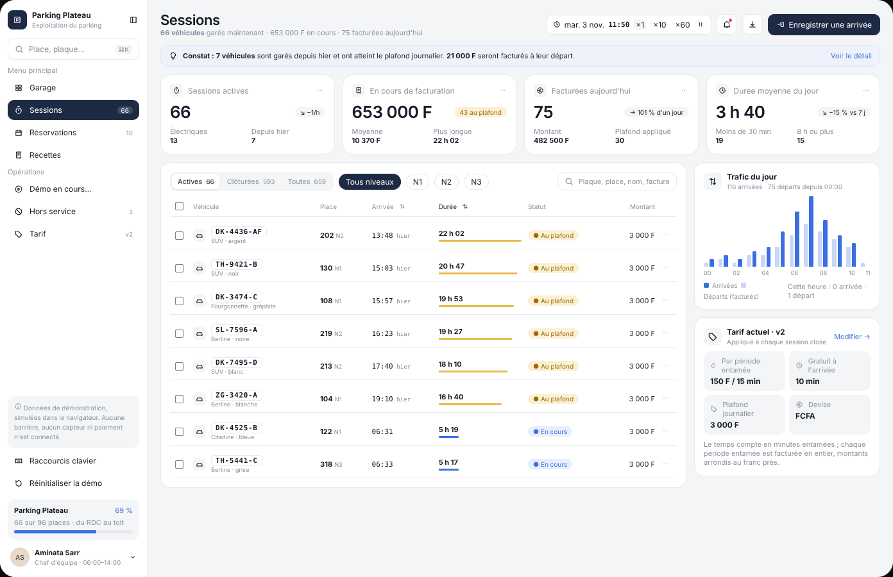
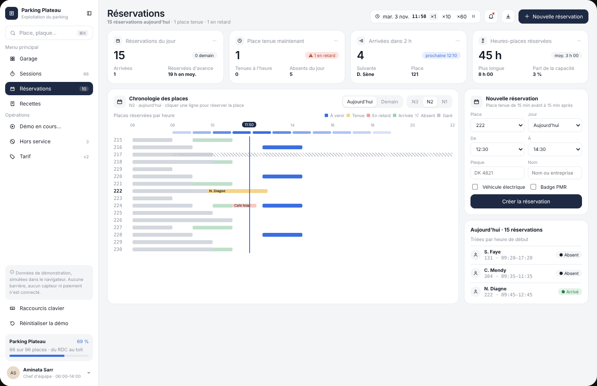
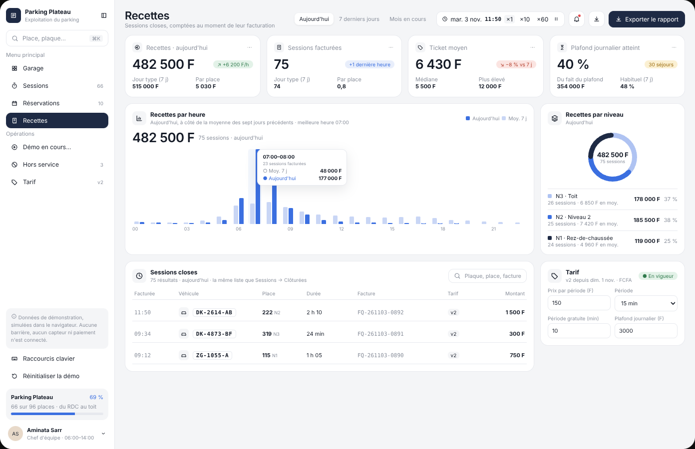

# Modèle 03 — Parking avec maquette 3D « Parking Plateau »

Tableau de bord d'exploitation d'un parking de 96 places sur trois niveaux : barre latérale complète, quatre indicateurs par vue, et au centre une **maquette 3D interactive** (niveaux isolables, vue éclatée, caméra qui vole vers la place choisie, démonstration guidée). Quatre vues : Garage, Sessions, Réservations, Recettes. Reconstruction originale d'après une démo publique de tableau de bord de parking : nom, données et code réécrits ; structure, constantes de caméra et timings relevés image par image.

| Vue éclatée | Sessions |
|---|---|
|  |  |
| **Réservations** | **Recettes** |
|  |  |

## Quand le choisir

- Tout ce qui a un **plan physique** : parking, entrepôt (allées et emplacements), salles d'un bâtiment, places d'un événement, étals d'un marché, chambres d'hôtel.
- Quand l'utilisateur doit **retrouver un objet dans l'espace** (« où est la place 222 ? ») et agir dessus (clore, réserver, signaler), puis suivre l'activité (sessions, réservations, recettes).

À éviter pour : données sans dimension spatiale (la 3D ne serait qu'une décoration), postes très modestes (prévoir le plan 2D en repli), écrans mobiles étroits.

## Relevé élément par élément

### Coquille

| Zone | Éléments |
|---|---|
| Barre latérale | logo carré marine + nom + « Exploitation du parking » + bouton replier · recherche « Place, plaque… » avec raccourci ⌘K · « Menu principal » : Garage, Sessions (compteur), Réservations (compteur), Recettes ; l'actif sur fond marine qui glisse · « Opérations » : lancer la démo / « Démo en cours… », Hors service (3), Tarif (v2) · encart gris « Données de démonstration… » · Raccourcis clavier · Réinitialiser la démo · carte de remplissage (nom, %, « N sur 96 places · du RDC au toit », barre bleue) · carte utilisateur (avatar, nom, poste et horaires, chevron) |
| En-tête | titre 22 px + sous-titre chiffré (parties en gras) · à droite : sélecteur de période (Recettes seulement) · horloge « mar. 3 nov. 11:50 » + vitesses ×1 / ×10 / ×60 + pause · bouton carré alertes avec point rouge · bouton carré téléchargement · action principale de la vue (Garage : « Mettre la démo en pause » en blanc ; Sessions : « Enregistrer une arrivée » ; Réservations : « Nouvelle réservation » ; Recettes : « Exporter le rapport », en marine) |
| Indicateurs | 4 cartes par vue : carré d'icône + titre gris + « ··· » · valeur 26 px · pastille de tendance colorée (verte, ambre, rouge, bleue, grise) · deux détails en colonnes |

### Garage

| Élément | Détail |
|---|---|
| Carte « Garage en direct » | carré d'icône cube · titre + sous-titre (« N2 isolé · étages supérieurs levés ») · segments Tous niveaux / N3 Toit / N2 / N1 Rez-de-chaussée avec le nombre de places libres |
| Maquette 3D | sol, route et passage piéton · dalles avec poteaux · places colorées par état, voitures sur les places occupées · place choisie en bleu avec **étiquette flottante** (son numéro) · glisser pour tourner (borné) · clic sur une place pour la choisir |
| Démonstration guidée | carte en haut à droite : « Démo · étape N sur 10 », vitesse ×2, pause, « Réinitialiser » · intitulé de l'étape (changement en fondu vertical) · barre de 10 segments (passés marine, en cours bleu, à venir gris) |
| Légende | en bas à gauche, pastille blanche : Libres, Réservées, Occupées, Hors service, avec les comptes du niveau affiché |
| Commandes | en bas à droite : bouton « Éclater / Regrouper » (marine quand actif) · groupe de trois boutons : tourner à gauche, recentrer, tourner à droite |
| Panneau de la place | « N2 · rangée sud » + croix · numéro 26 px + pastille d'état · ticket gris : icône voiture, plaque à chasse fixe, modèle · couleur · conducteur, Arrivée / Durée / À payer, bouton marine « Clore la session et facturer … » (ou « Enregistrer une arrivée ici ») |
| Plan des places | « Plan des places · N2 » + place choisie · 2 rangées de 16 cases colorées séparées par « ALLÉE », hors service hachuré, choisie en bleu ; un clic choisit la place dans la maquette |
| Rangée basse | Occupation aujourd'hui (courbe bleue avec aire, objectif 85 % en tirets orange, pastille marine sur la dernière valeur) · Durée de stationnement (barres groupées aujourd'hui / moyenne 7 j) · Usage par niveau (anneau à 3 segments, total au centre, légende chiffrée) · Arrivées en direct (« Tout voir », plaque, place, ancienneté, pastille Garé / Parti) |

### Sessions

| Élément | Détail |
|---|---|
| Constat | bandeau bleu pâle : ampoule, « Constat : 7 véhicules… » avec les chiffres en gras, lien « Voir le détail » |
| Tableau | segments Actives / Clôturées / Toutes avec compteurs · puces de niveau (Tous niveaux en marine, N1, N2, N3) · recherche · colonnes : case à cocher, véhicule (icône, plaque, type · couleur), place (numéro gras + niveau gris), arrivée (heure à chasse fixe + « hier »), **durée** (valeur + barre proportionnelle, ambre si plafond), statut (« ● Au plafond » ambre, « ● En cours » bleu), montant, « ··· » · lignes cochées surlignées |
| Trafic du jour | barres groupées arrivées (bleu) / départs facturés (bleu pâle) par heure · légende · « Cette heure : 0 arrivée · 1 départ » |
| Tarif actuel | « Modifier → » · 4 tuiles (par période entamée, gratuit à l'arrivée, plafond journalier, devise) · règle de calcul en petit |

### Réservations

| Élément | Détail |
|---|---|
| Chronologie des places | segments Aujourd'hui / Demain et N3 / N2 / N1 · légende (À venir, Tenue, En retard, Arrivée, Absent hachuré, Garé) · axe horaire 06–22 avec pastille marine « 11:50 » et trait vertical bleu de l'heure courante · bande de densité « places réservées par heure » · une ligne par place avec ses blocs colorés et le nom sur les réservations ; la place 222 en gras |
| Nouvelle réservation | « Place tenue de 15 min avant à 15 min après » · Place, Jour, De, À (listes), Plaque, Nom · cases Véhicule électrique, Badge PMR · bouton marine « Créer la réservation » |
| Réservations du jour | « Triées par heure de début » · icône, nom, place · créneau (chasse fixe), pastille Absent / Arrivé |

### Recettes

| Élément | Détail |
|---|---|
| Recettes par heure | titre + sous-titre (meilleure heure) · légende · total 26 px + « 75 sessions · aujourd'hui » · 24 paires de barres · survol : colonne surlignée et bulle (créneau, sessions, moyenne 7 j, aujourd'hui) |
| Recettes par niveau | anneau à 3 segments, total au centre · 3 lignes : couleur, niveau, sessions et moyenne, montant, part |
| Sessions closes | recherche · colonnes heure de facturation, véhicule, place, durée, n° de facture (chasse fixe), version du tarif (pastille « v2 »), montant |
| Tarif | pastille verte « En vigueur » · « v2 depuis dim. 1 nov. · FCFA » · champs prix par période, période, période gratuite, plafond journalier |

## Fichiers

| Fichier | Contenu |
|---|---|
| `exemple.tsx` | Composant React + `three` (scène écrite à la main) + `motion` ; quatre vues ; données fictives cohérentes (96 places, indicateurs calculés depuis les places) |
| `style.md` | Tokens de l'interface et couleurs de la scène |
| `animations.md` | Préréglages de caméra, amorti, vue éclatée, isolement de niveau, démonstration guidée, graphiques |
| `apercu.png`, `eclate.png`, `sessions.png`, `reservations.png`, `recettes.png` | Rendu du composant |

## Adapter

- **Remplacer la géométrie** par le vrai plan : niveaux, rangées, places par rangée, numérotation. Garder des volumes simples.
- **Calculer les indicateurs depuis les données** (comme `TOTAL_OCCUPEES`) : un compte affiché dans la légende, l'en-tête et la barre latérale doit être le même partout.
- **Repli 2D obligatoire** : sans WebGL ou sous 768 px, n'afficher que le plan des places (mêmes couleurs, même clic).
- Montants en FCFA dans l'exemple : adapter la devise et le tarif.
