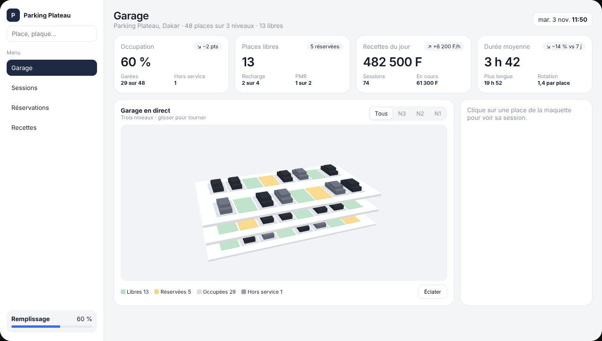
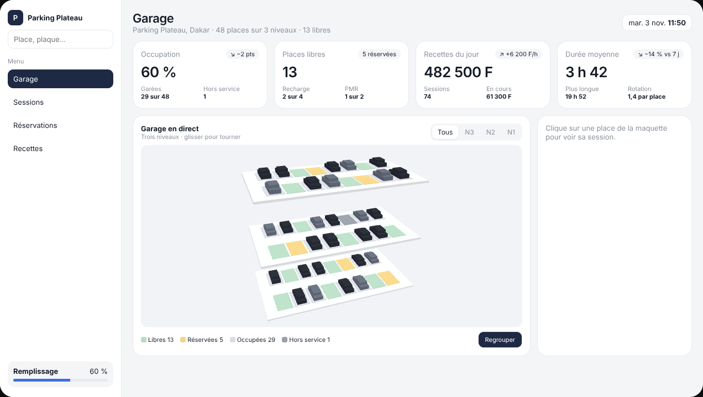
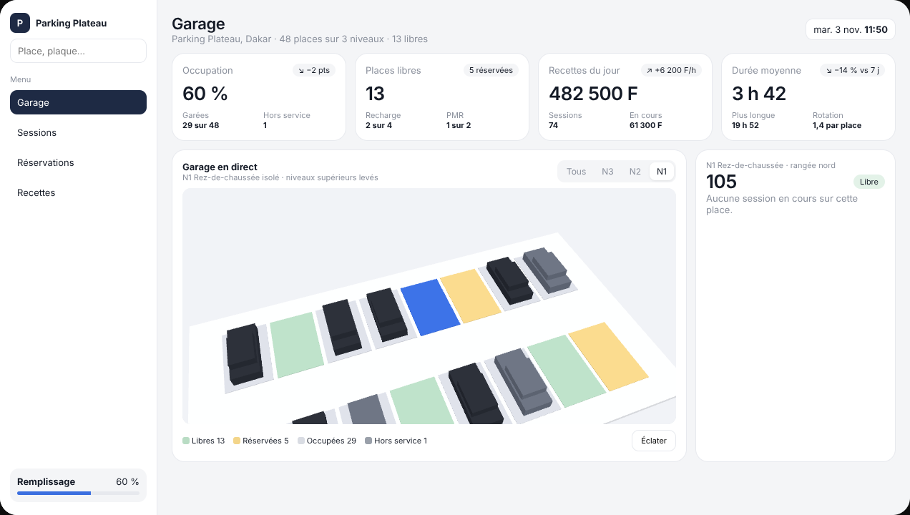

# Modèle 03 — Parking avec maquette 3D « Parking Plateau »



Tableau de bord d'exploitation avec une **maquette 3D interactive** au centre : les niveaux du parking empilés, chaque place colorée selon son état, une caméra qui **vole** vers le niveau ou la place choisie, et une **vue éclatée** qui écarte les étages. Autour : barre latérale, quatre indicateurs, panneau de détail de la place. Reconstruction originale d'après une démo publique de tableau de bord de parking : nom, données et code réécrits.

| Vue éclatée | Place choisie |
|---|---|
|  |  |

## Quand le choisir

- Tout ce qui a un **plan physique** : parking, entrepôt (allées et emplacements), salles d'un bâtiment, places d'un événement, étals d'un marché, chambres d'hôtel.
- Quand l'utilisateur doit **retrouver un objet dans l'espace** (« où est la place 222 ? ») et agir dessus (clore, réserver, signaler).

À éviter pour : données sans dimension spatiale (la 3D ne serait qu'une décoration), postes très modestes (la 3D demande un GPU correct ; prévoir le plan 2D en repli), écrans mobiles étroits (passer au plan 2D par niveau).

## Structure

```
Barre latérale   logo · recherche (place, plaque) · menu (actif marine) · remplissage en bas
En-tête          titre · résumé chiffré (places, niveaux, libres) ····························· horloge
Indicateurs      4 cartes : valeur, tendance en pastille, deux détails
Milieu           carte « Garage en direct » : segments de niveau (Tous / N3 / N2 / N1), toile 3D,
                 légende des états avec comptes, bouton Éclater | panneau de la place choisie
```

## Ce qui fait l'effet

1. **La 3D est un outil, pas un décor** : chaque clic sur une place ouvre sa session, chaque niveau se lit seul.
2. **Caméra bornée** : rotation limitée à ±40° et inclinaison entre ≈ 22° et ≈ 72°, impossible de « perdre » la maquette.
3. **Isoler un niveau** lève et efface les étages du dessus au lieu de les cacher d'un coup : on garde le repère spatial.
4. **Couleurs d'état douces** (vert, ocre, gris) et **une seule couleur vive**, le bleu, pour la place choisie.
5. **Interface 2D sobre** autour (marine, gris clair, bordures fines) pour que la maquette reste le centre.

## Fichiers

| Fichier | Contenu |
|---|---|
| `exemple.tsx` | Composant React + `three` (scène écrite à la main, sans bibliothèque 3D supplémentaire) + `motion` pour l'interface |
| `style.md` | Tokens de l'interface et couleurs de la scène |
| `animations.md` | Préréglages de caméra, amorti, vue éclatée, isolement de niveau, cascade de l'interface |
| `apercu.png`, `eclate.png`, `place.png` | Rendu du composant |

## Adapter

- **Remplacer la géométrie** par le vrai plan : nombre de niveaux, rangées, places par rangée. Garder des volumes simples (boîtes) : un modèle détaillé alourdit sans rien apprendre à l'utilisateur.
- **Les états** viennent des données (capteurs, sessions, réservations) ; la légende affiche les comptes réels.
- **Repli 2D obligatoire** : si WebGL n'est pas disponible ou si l'écran fait moins de 768 px, afficher un plan en grille par niveau (mêmes couleurs, même clic).
- Pour un projet qui utilise déjà React Three Fiber, reprendre les mêmes constantes et le même amorti dans `useFrame`.
- Montants en FCFA dans l'exemple : adapter la devise et le tarif.
