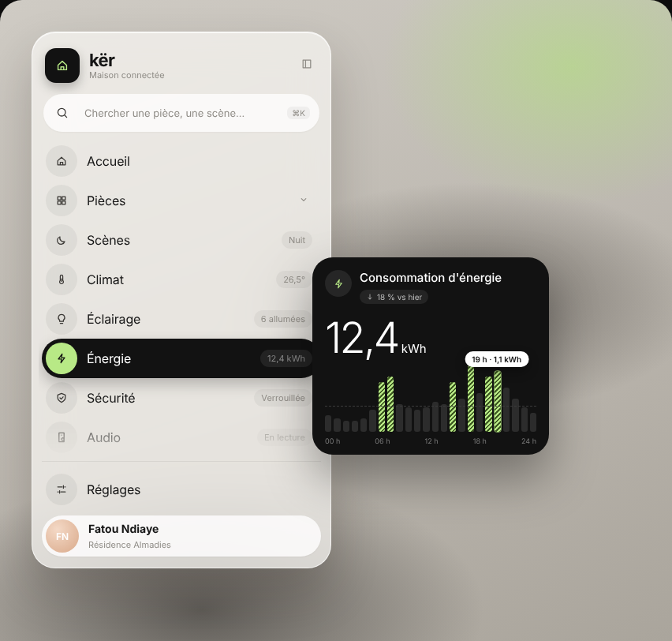
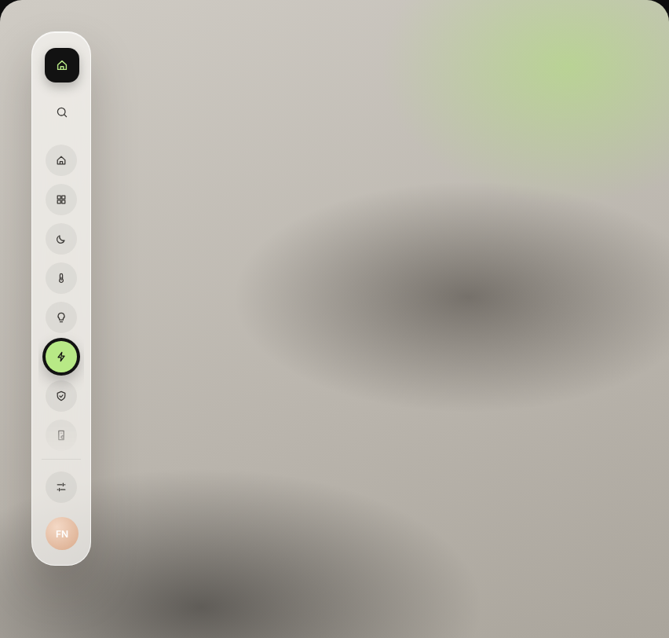
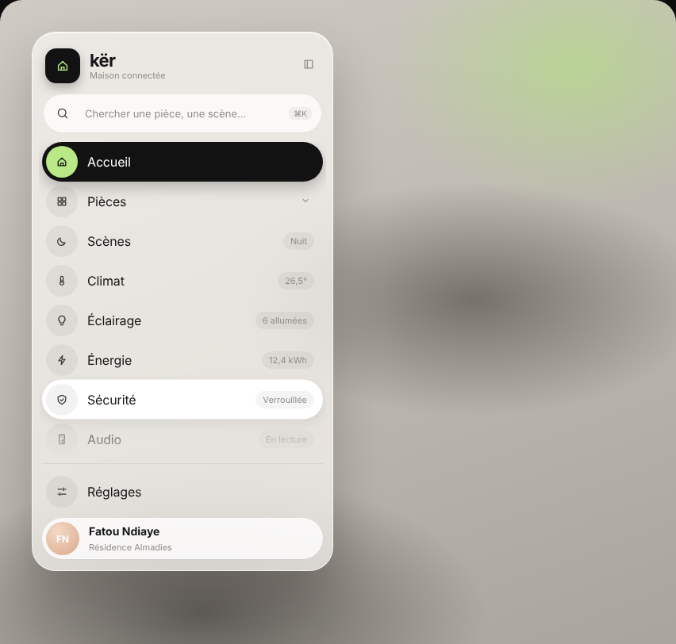
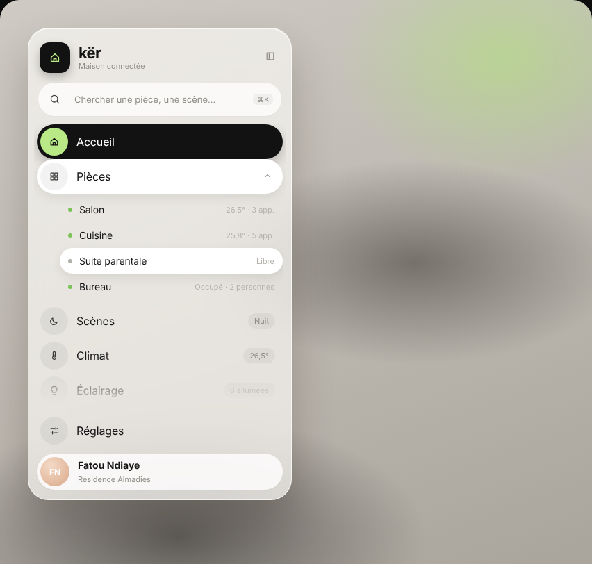

# Modèle 04 — Barre latérale « Kër » (maison connectée)

**Composant** de navigation plutôt qu'écran complet : un rail compact de 76 px qui se **déplie** en barre latérale de 380 px en **verre dépoli** posé sur une photo floue, une **pilule noire** qui glisse d'une entrée à l'autre (icône sur disque citron vert), un accordéon de pièces, et une **fenêtre de détail noire** qui sort à côté de l'entrée active, avec un grand chiffre qui compte et un graphique horaire. Reconstruction originale d'après un concept d'interface public de maison connectée : nom, textes, données et code réécrits ; proportions et timings relevés image par image.

| Rail replié | Barre dépliée, survol | Pièces en accordéon |
|---|---|---|
|  |  |  |

## Quand le choisir

- Navigation principale d'une application **domotique, IoT, gestion de bâtiment, objets connectés**, où chaque entrée porte un **état** (« Verrouillée », « 26,5° », « 3 en direct »).
- Toute barre latérale qui doit pouvoir se **replier en rail** (écran partagé, tablette) sans perdre l'entrée active.
- La fenêtre de détail se réutilise pour n'importe quelle entrée qui a une mesure (énergie, eau, climat).

À éviter pour : outils de saisie denses (les lignes de 50 px prennent de la place), fonds unis (le verre dépoli n'a d'intérêt que sur une image ou un dégradé).

## Relevé élément par élément

| Zone | Éléments |
|---|---|
| Fond | photo intérieure très floue (gris chaud, tache de verdure en haut à droite, masses sombres) ; ici recréée en dégradés radiaux |
| Panneau | verre dépoli (fond blanc cassé à 72 %, flou 24 px, saturation 140 %), liseré blanc, rayon 30 px, ombre portée large et douce, reflet blanc en haut |
| En-tête | carré noir arrondi 44 px avec la maison en citron vert · nom en minuscules 22 px + « Maison connectée » gris · bouton « replier » (icône de barre latérale) à droite |
| Recherche | pilule blanche : loupe, « Chercher une pièce, une scène… », touche « ⌘K » dans une pastille grise ; ⌘K ou Ctrl+K ouvre la barre et place le curseur |
| Entrées | 10 lignes de 50 px : icône dans un disque gris de 40 px · libellé 16 px · **valeur d'état** à droite dans une pastille grise (Nuit, 26,5°, 6 allumées, 12,4 kWh, Verrouillée, En lecture, 3 en direct, 12) |
| Entrée active | pilule noire pleine largeur, ombre portée, disque citron vert sous l'icône, libellé blanc, valeur grise sur fond translucide ; la pilule **glisse** vers la nouvelle entrée |
| Survol | pilule blanche avec ombre légère, qui glisse aussi d'une ligne à l'autre |
| Accordéon « Pièces » | chevron qui pivote · sous-liste décalée avec un **filet vertical** à gauche · point vert (occupée / allumée) ou gris · nom 14 px · information grise à droite (« 26,5° · 3 app. », « Libre », « Occupé · 2 personnes ») · survol en pilule blanche |
| Défilement | la liste défile seule, barre de défilement fine, **fondu en bas** (les dernières lignes pâlissent) |
| Pied | filet de séparation · « Réglages » · carte utilisateur en pilule blanche : avatar en dégradé pêche, nom, résidence ; un clic replie ou déplie la barre |
| Rail replié | mêmes icônes empilées dans leurs disques ; entrée active = disque citron vert **cerclé de noir** ; recherche en simple loupe ; avatar seul en bas |
| Fenêtre de détail | carte noire 300 px, rayon 26 px, collée au bord du panneau et centrée sur la ligne active (la pilule noire semble s'y prolonger) · disque sombre avec l'éclair citron vert · titre · pastille « ↓ 18 % vs hier » · chiffre 54 px graisse 300 qui compte de 0 à 12,4 + « kWh » · 24 barres gris anthracite, heures de pointe **hachurées en citron vert** · ligne moyenne en pointillé · bulle blanche « 19 h · 1,1 kWh » qui suit le survol · axe 00 h – 24 h |

## Fichiers

| Fichier | Contenu |
|---|---|
| `exemple.tsx` | Composant React (`motion` uniquement), données fictives |
| `style.md` | Verre dépoli, couleurs, tailles |
| `animations.md` | Déploiement, pilules qui glissent, accordéon, fenêtre de détail, compteur |
| `rail.png`, `depliee.png`, `pieces.png`, `energie.png` | Rendu du composant |

## Adapter

- **Entrées** : garder une valeur d'état à droite seulement quand elle est utile d'un coup d'œil ; sinon rien (comme « Accueil »).
- **Accent** : le citron vert ne sert qu'à l'entrée active et aux pointes du graphique ; le remplacer par la couleur de la marque, en gardant le noir pour la pilule.
- **Fond** : poser le panneau sur une vraie photo floue ou un dégradé ; sur fond uni, enlever le verre dépoli et passer en blanc à 96 %.
- **Accessibilité** : `aria-current="page"` sur l'entrée active, `title` sur les icônes du rail replié, contraste du texte gris sur le verre à vérifier sur la vraie photo.
