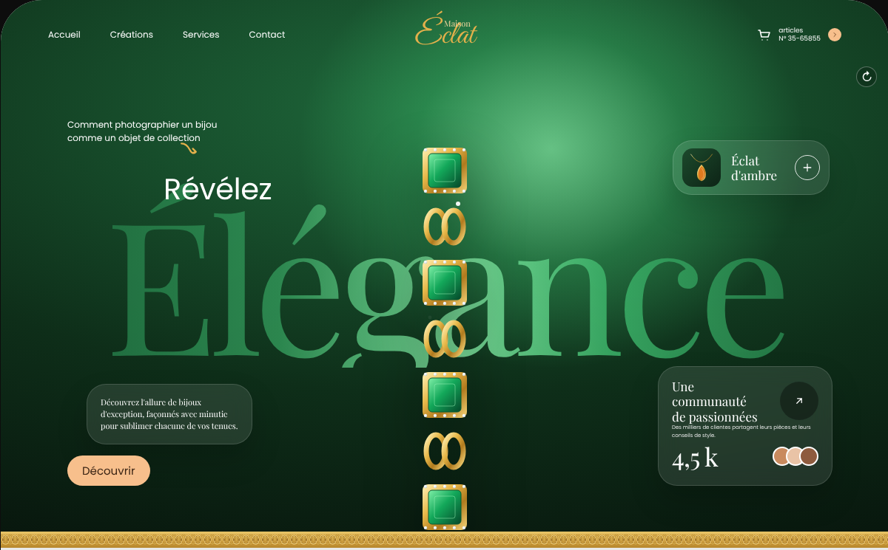
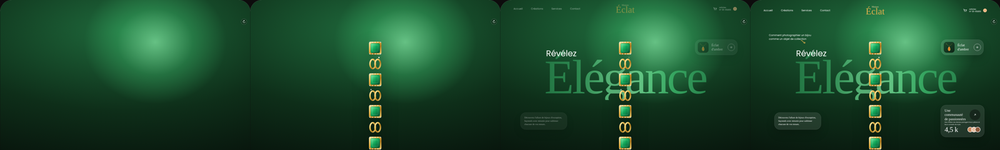

# Modèle 05 — Vitrine de joaillerie « Maison Éclat »

**Landing page de luxe** : héros vert profond éclairé par un halo, **mot géant en serif** derrière le bijou, cartes en **verre fumé**, séparations en **chaîne d'or**, puis sections claires sur motif discret (créations, nouveautés, collections) et pied de page vert avec logo calligraphié. Reconstruction originale d'après une maquette publique de site de joaillerie : marque, textes, illustrations et code réécrits ; structure, proportions et séquence d'ouverture relevées sur les images et la vidéo.

> Les **photos** de la référence (main, bijoux, mannequin) **ne sont pas reprises** : les bijoux sont dessinés en SVG pour que le modèle fonctionne seul. Pour un vrai site, passer une photo détourée en PNG (prop `photoHeros`) et remplacer les illustrations des grilles par des photos produit sur fond neutre.

| Séquence d'ouverture (0,3 s · 0,8 s · 1,5 s · 2,3 s) |
|---|
|  |

Page entière : `page.png`.

## Quand le choisir

- Vitrine de **marque premium** : bijouterie, horlogerie, parfums, maroquinerie, cosmétiques, mode de cérémonie.
- Page où **un produit unique** doit dominer le premier écran, avec peu de texte.

À éviter pour : catalogues à forte rotation (la grille de 6 catégories ne remplace pas une liste filtrable), sites où la vitesse prime sur l'ambiance (polices et halos pèsent).

## Relevé élément par élément

| Zone | Éléments |
|---|---|
| Héros : fond | coins supérieurs arrondis 56 px · dégradé radial vert nuit → vert forêt · **halo vert clair** derrière le sujet, en haut à droite du centre |
| Héros : navigation | 4 liens Poppins 12 px à gauche · logo au centre (petit mot serif au-dessus d'un grand mot calligraphié or) · à droite : panier, « articles / N° de commande » sur deux lignes, pastille pêche avec chevron |
| Héros : accroche | deux lignes Poppins 12 px en haut à gauche + flèche courbe or |
| Héros : titre | petit mot blanc 40 px (« Révélez ») posé sur le **mot géant serif** 250 px (« Élégance ») en dégradé horizontal vert foncé → vert clair au centre → vert foncé, derrière le sujet |
| Héros : sujet | photo détourée (ici : bracelet d'or et d'émeraudes en SVG) au centre, qui dépasse en bas, ombre portée, éclats qui scintillent |
| Héros : cartes en verre | à droite en haut : vignette produit + nom en serif sur deux lignes + bouton rond « + » cerclé de blanc · à gauche : texte d'ambiance en serif 11 px · à droite en bas : « Une communauté de passionnées » serif 17 px, bouton rond sombre « ↗ », texte 7 px, chiffre « 4,5 k » serif 34 px, avatars superposés |
| Héros : action | pilule **pêche** « Découvrir » en bas à gauche |
| Chaîne d'or | frise de 22 px de maillons ovales dorés, entre le héros et la section claire, et avant le pied de page |
| Section claire | fond gris clair à **motif géométrique** très pâle · titre serif 46 px centré + sous-titre gris 18 px |
| Créations | grille 3 × 2 de cartes **verre clair** (256 × 290 px, rayon 40 px, liseré blanc) : bijou au centre, nom en serif 22 px dessous |
| Nouveautés | grande carte verre clair (rayon 44 px) : **halo vert flou** à gauche, titre serif gras 40 px sur deux lignes, paragraphe, pilule **verte en dégradé** avec rond blanc et icône ; visuel produit à droite |
| Collections emblématiques | titre + sous-titre · grille 3 × 2 de tuiles **vert nuit** (330 px, rayon 52 px, ombre intérieure), un bijou éclairé par tuile |
| Pied de page | fond vert en dégradé radial · horaires du service client + 4 icônes de réseaux en ronds blancs · champ d'abonnement en pilule blanche (icône, champ, bouton vert « S'abonner ») · case de consentement + « En savoir plus » · sélecteur de langue en pilule contour avec drapeau · « Service client international » · **logo calligraphié géant** pêche · mention de droits en 10 px |

## Fichiers

| Fichier | Contenu |
|---|---|
| `exemple.tsx` | Page React (`motion`), illustrations SVG des bijoux, séquence d'ouverture rejouable (bouton ↻), apparitions au défilement |
| `style.md` | Couleurs, verre, chaîne d'or, typographies |
| `animations.md` | Séquence d'ouverture minutée, apparitions au défilement, survols |
| `heros.png`, `sequence.png`, `page.png` | Rendu |

## Adapter

- **La photo du héros fait tout** : un produit détouré, éclairé de côté, sur fond transparent ; le halo vert doit tomber derrière lui.
- **Le mot géant** : un seul mot de 7 à 9 lettres, qui remplit la largeur ; le sujet passe devant.
- **Couleurs** : vert émeraude + or + pêche sont liés aux pierres montrées ; pour du saphir, passer au bleu nuit + or + crème, en gardant la même logique (fond nuit, halo clair, accent chaud pour l'action).
- **Polices** : Playfair Display (titres), Great Vibes (logo), Poppins (texte) ; les charger avec `display=swap`.
- **Ne jamais reprendre** de nom de collection ou de modèle d'une autre maison (ce sont des marques déposées) ni ses photos.
