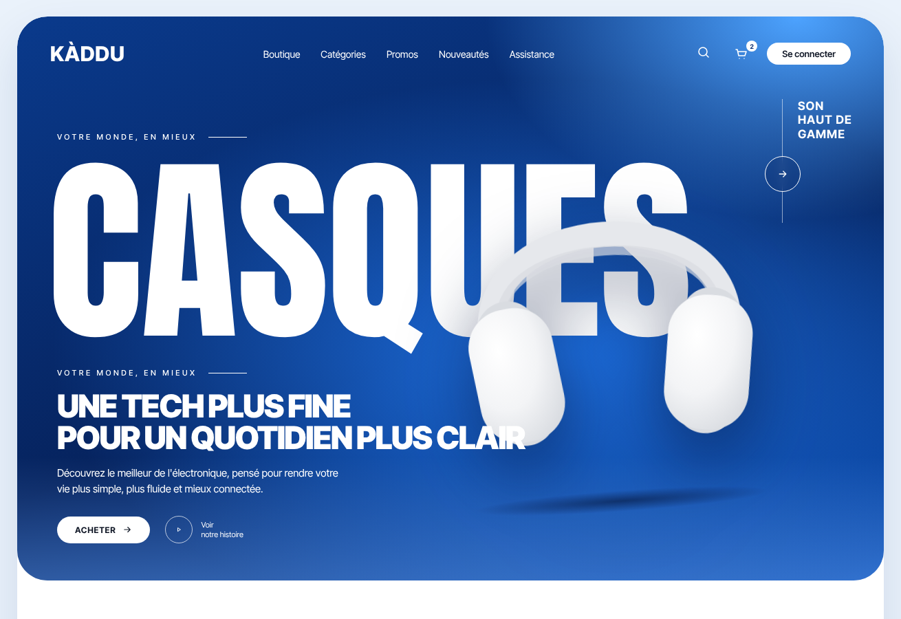

# Modèle 06 — Boutique audio « Kàddu »

**Landing page e-commerce d'électronique** : héros bleu profond avec **mot géant condensé** derrière le produit, barre de garanties, carrousel de catégories qui déborde du cadre, bannière promotionnelle claire, rangée de marques et pied de page noir arrondi. Reconstruction originale d'après une maquette publique de boutique de casques : marque, textes, illustrations et code réécrits ; structure, proportions et couleurs relevées sur les images.

> Les **photos** (casques, mise en scène) et les **logos de marques** de la référence ne sont **pas repris** : produits dessinés en SVG, marques inventées. Pour un vrai site, passer une photo détourée (prop `photoHeros`) et les logos des marques réellement distribuées, avec leur accord.

Page entière : `page.png`.

## Quand le choisir

- Boutique en ligne d'**un rayon** (audio, téléphonie, petit électroménager, sport) qui met un produit phare en avant.
- Page d'accueil qui doit à la fois **impressionner** (héros) et **orienter** (catégories, marques).

À éviter pour : catalogues de centaines de références sans produit phare, sites institutionnels (le mot géant et le bleu saturé sont commerciaux).

## Relevé élément par élément

| Zone | Éléments |
|---|---|
| Cadre | page bleu très pâle `#EAF2FB` · conteneur blanc arrondi 44 px, ombre bleutée |
| Héros : fond | 820 px de haut, coins 44 px · dégradé bleu nuit → bleu roi, **reflet clair en haut à droite**, voile plus clair en bas |
| Héros : navigation | marque en capitales grasses à gauche · 5 liens au centre · loupe, panier avec **pastille blanche** du nombre d'articles, pilule blanche « Se connecter » |
| Héros : mot géant | surtitre espacé « VOTRE MONDE, EN MIEUX » + trait · **mot condensé blanc 290 px** (« CASQUES ») sur toute la largeur, derrière le produit |
| Héros : produit | casque blanc incliné de −4°, ombre portée bleu nuit et ombre au sol, flotte doucement |
| Héros : bloc droit | « SON / HAUT DE / GAMME » en capitales grasses sur trois lignes, **filet vertical** à gauche, bouton rond contour avec flèche posé sur le filet |
| Héros : bloc bas gauche | surtitre + trait · titre **noir 900, 46 px, deux lignes** · paragraphe 15 px · pilule blanche « ACHETER → » · rond contour ▶ + « Voir / notre histoire » |
| Garanties | carte à liseré 1,5 px, rayon 20 px, 4 colonnes séparées par des filets : icône au trait 26 px + titre 13 px + détail gris 12 px |
| Catégories | « ACHETER PAR CATÉGORIE » espacé · boutons ‹ › ronds à liseré + « Tout voir → » · **rail horizontal** de cartes 228 px qui sort du cadre à droite (défilement aimanté) · chaque carte : fond gris pâle, vignette colorée 224 px (gris, bleu ciel, crème, olive) avec le produit, nom + « et N % de remise », rond flèche |
| Bannière | 400 px, rayon 30 px, fond bleu glacier · titre **noir 900, 60 px** sur deux lignes avec **trait** après la deuxième ligne · sous-titre 22 px · pilule **marine** « Voir la collection → » · à droite : produit crème posé sur des livres, rais de lumière en biais |
| Marques | étiquette très espacée « MARQUES PHARES » + trait, « Tout voir → » · 6 mots-symboles noirs répartis sur la largeur, chacun dans un style différent |
| Pied de page | bloc **noir** arrondi 40 px, en retrait de 10 px · logo (icône or + mot condensé + sous-titre minuscule) · paragraphe gris · 3 ronds de réseaux · 2 pastilles contour · 3 colonnes de liens (titre espacé 12 px, liens gris 14 px) · filet · droits, liens légaux, langue avec globe |

## Fichiers

| Fichier | Contenu |
|---|---|
| `exemple.tsx` | Page React (`motion`), casques et écouteurs en SVG, rail de catégories avec boutons de défilement, panier qui s'incrémente |
| `style.md` | Couleurs, typographies, formes |
| `animations.md` | Animations (toutes ajoutées : la référence est une image fixe) |
| `heros.png`, `page.png` | Rendu |

## Adapter

- **Le mot géant** = la catégorie du produit phare, 6 à 8 lettres, en police condensée (Anton, Bebas Neue, Oswald) ; le produit passe devant.
- **Une couleur de marque saturée** pour le héros, puis tout le reste en blanc, gris pâle et noir ; l'accent ne revient que sur le bouton de la bannière.
- **Catégories** : 5 à 8 cartes, fonds de vignettes tirés des couleurs des produits ; le rail doit **déborder** pour signaler qu'on peut faire défiler.
- **Paiement** : citer les moyens réellement acceptés (ici Wave, Orange Money, carte).
- **Ne jamais reprendre** les logos des marques sans autorisation : en attendant, des mots-symboles neutres.
