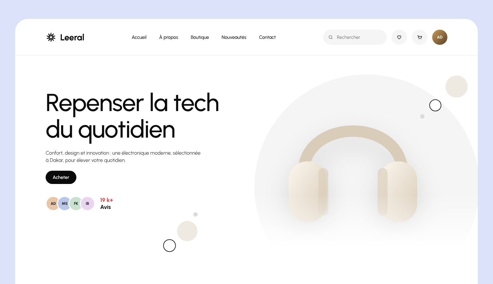

# Modèle 07 — Boutique high-tech « Leeral »

**Page d'accueil e-commerce claire et multi-rayons** (téléphones, audio, écrans, jeux) : héros blanc avec sujet dans un grand disque gris et bulles décoratives, mosaïque « nos choix », carrousels de produits à pastilles de couleur, bannières pleine largeur, cartes catégories à hauteurs variées, grilles et pied de page clair. Tout repose sur **une seule grammaire** : titres 64 à 78 px en graisse moyenne, cartes gris très pâle arrondies 24 px, pilules noires « Acheter », pilule contour « Tout voir ». Reconstruction originale d'après une maquette publique de boutique d'électronique : marque, textes, illustrations et code réécrits ; structure, proportions et ordre des sections relevés sur les images.

> La référence est **entièrement photographique** et montre des **produits de marques réelles** : rien n'en est repris. Les produits sont dessinés en SVG, les noms inventés, les prix en francs CFA. Pour un vrai site, remplacer chaque `<Produit>` par une photo détourée sur fond neutre (et `photoHeros` pour le héros).

Page entière (réduite de moitié) : `page.png`.

## Quand le choisir

- Boutique **multi-rayons** où l'on veut montrer beaucoup de produits sans surcharger : la page alterne grilles denses et grandes respirations.
- Marque qui veut un ton **calme et premium** sans couleur forte : l'accent vient des produits et de deux bannières colorées.

À éviter pour : une boutique d'un seul produit (prendre le modèle 06), un site sans photos de qualité (la page en dépend entièrement).

## Relevé élément par élément

| Zone | Éléments |
|---|---|
| Cadre | page lavande `#DCE2F9` · conteneur blanc arrondi 40 px · marges intérieures 96 px |
| Navigation | 116 px, filet gris dessous · logo (rosace noire) + nom 28 px · 5 liens 15 px au centre · champ de recherche en pilule grise avec loupe · ronds gris favoris et panier · avatar rond |
| Héros | titre **78 px, graisse 500, deux lignes** · paragraphe 16 px · pilule noire · 4 avatars qui se chevauchent + « **19 k+** » en corail sur « Avis » · à droite, **grand disque gris très pâle** (710 px) avec le sujet, fondu en blanc vers le bas · **6 bulles** : rond beige plein, rond à contour noir, petit point gris, en deux groupes (haut droite, milieu) |
| Nos choix | titre 68 px + « Tout voir » · **mosaïque 4 colonnes × 3 rangées de 310 px**, écart 16 px : grande carte 2 × 2 (dégradé gris vers noir, titre blanc 46 px, sous-titre, pilule blanche), carte large 2 × 1 (rond blanc ↗ au centre), carte haute 1 × 2, deux petites cartes (bouton rond blanc « sac » en bas à droite), carte large 2 × 1 en bas à gauche (rond ↗) |
| Nouveautés | rail de cartes 460 × 460 qui **sort du cadre à droite** · carte gris `#F6F6F6` : produit centré, nom 22 px, pastilles de couleur (la choisie entourée) + nom de la teinte, prix **gras italique** 24 px + ancien prix barré · sous le rail, **double bouton** ← (blanc) → (noir) centré |
| Bannière bleue | **pleine largeur**, 690 px, bleu acier `#567C9E` · **mot fantôme géant** (430 px, plus sombre) en bas à gauche · titre blanc 72 px, paragraphe, pilule blanche · produit à droite avec ombre |
| Catégories | titre + « Tout voir » · 4 cartes de **hauteurs différentes** (365, 455, 365, 320 px) **alignées en bas**, fond photo, dégradé noir en bas, nom blanc 20 px, « dès » + prix gras 22 px |
| Deux promotions | deux cartes de 545 px **collées aux bords du cadre**, écart 20 px · beige et gris · visuel à gauche, à droite titre 44 px sur trois lignes, phrase 14 px, pilule noire |
| Tendances | grille 3 × 2 · carte : produit, nom + prix gras italique à gauche, **filet vertical** puis pastilles à droite |
| Grande carte | carte gris pâle 585 px : titre 64 px sur trois lignes, paragraphe, pilule ; produit en gros plan **coupé par le bord droit** |
| Bonnes affaires | 3 cartes sombres 460 px, produit, nom + « dès » + prix en blanc |
| Bannière beige | carte `#EDE8E1` 475 px : titre 64 px sur deux lignes, paragraphe, pilule ; à droite mise en scène (téléviseur, meuble en bois, plantes, lampe coupée par le coin) |
| Dernière gamme | 4 cartes gris pâle 340 px : nom gras 22 px en haut, produit, pilule noire en bas à gauche |
| Pied de page | logo à gauche, 4 liens à droite · présentation + « Recevoir la lettre » avec champ en pilule et bouton noir **intégré** · 4 colonnes de liens gris 15 px · filet · droits à gauche, **5 ronds à contour** (réseaux) à droite |

## Fichiers

| Fichier | Contenu |
|---|---|
| `exemple.tsx` | Page React (`motion`) : 12 produits en SVG, téléphones à teinte variable, mosaïque en `grid-template-areas`, rail avec défilement, diaporama de la bannière, pastilles de couleur à anneau partagé |
| `style.md` | Couleurs, typographie, grilles et formes |
| `animations.md` | Animations (toutes ajoutées : la référence est une suite d'images fixes) |
| `heros.png`, `page.png` | Rendu |

## Adapter

- **Les photos font la page** : produits détourés ou mis en scène sur fond uni, éclairage doux ; garder les dégradés sombres en bas des cartes à texte blanc pour la lisibilité.
- **La grammaire ne bouge pas** : un rayon = un titre 64–68 px + « Tout voir » + une grille ; ne pas inventer une autre forme de carte par section.
- **Rythme** : alterner une section dense (grille, rail) et une respiration (bannière, grande carte). Ici : héros, mosaïque, rail, bannière, catégories, promotions, grille, grande carte, cartes sombres, bannière, grille.
- **Prix** : en francs CFA, avec l'ancien prix barré seulement s'il y a une vraie remise.
- **Fêtes locales** pour la grande carte (Tabaski, Korité, Noël, rentrée).
