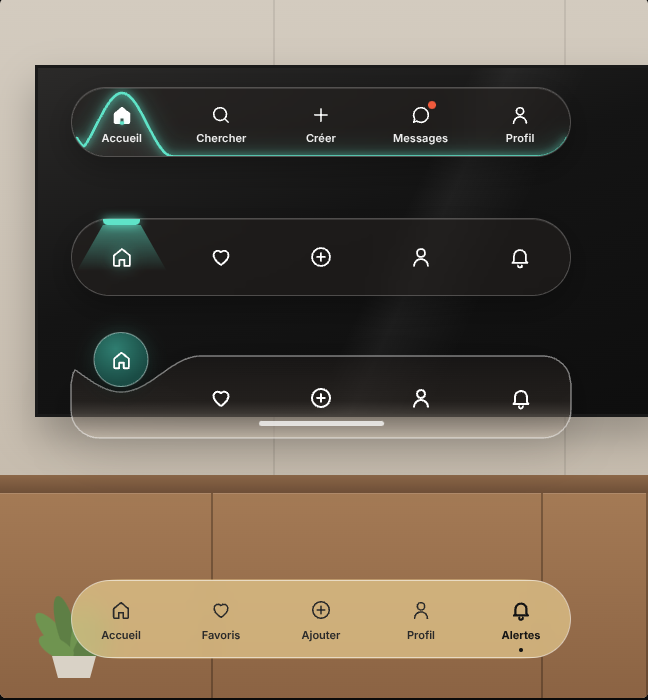
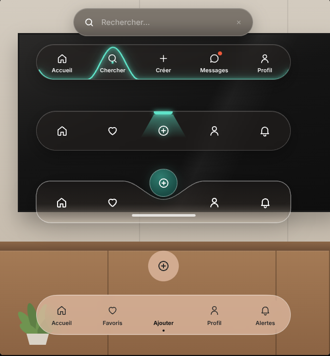

# Modèle 08 — Barres d'onglets en verre

| Au repos | Onglets changés (recherche ouverte, goutte en vol) |
|---|---|
|  |  |

**Composant** : quatre variantes de **barre de navigation basse** en verre, chacune avec sa façon de marquer l'onglet actif. Reconstruction originale d'après une démonstration vidéo publique (barres posées sur une photo de salon) : code, décor et libellés réécrits ; formes, tailles et durées relevées image par image puis ramenées à l'échelle 0,6 (barres de 500 px).

| Variante | Composant | Repère de l'onglet actif |
|---|---|---|
| 1 | `BarreNeon` | **trait turquoise lumineux** qui longe le bas de la barre et se soulève **en cloche** autour de l'onglet actif ; icône pleine, point turquoise ; ouvre un **champ de recherche** au-dessus quand « Chercher » est actif |
| 2 | `BarreProjecteur` | **petit projecteur** turquoise sur le bord haut, **cône de lumière** qui descend sur l'icône |
| 3 | `BarreCreux` | **pastille ronde** turquoise sombre qui dépasse du bord haut, posée dans un **creux** de la barre qui la suit |
| 4 | `BarreGoutte` | l'icône sort de la barre comme une **goutte de liquide**, se détache, flotte, puis retombe et fusionne ; la barre se resserre et **change de teinte** |

Chaque barre s'utilise seule (`import { BarreGoutte } from "./exemple"`) ; le composant par défaut les montre ensemble sur un décor dessiné en CSS (`fond` pour passer le vôtre).

## Quand le choisir

- Application mobile ou web mobile avec **3 à 5 destinations** principales.
- Interface posée sur une **image ou un fond riche** (le verre n'a d'intérêt que s'il y a quelque chose derrière).
- Variante 1 si la recherche est une destination ; 2 ou 3 pour une barre sans libellés ; 4 pour une marque ludique (le cycle de 0,9 s est trop long pour un outil de travail).

À éviter pour : plus de 5 onglets, fond uni (prendre une barre pleine), navigation de bureau.

## Relevé élément par élément (vidéo, 9,7 s ; démonstration jusqu'à 5,7 s, puis carton de fin)

| Barre | Éléments |
|---|---|
| Toutes | verre fumé sombre, liseré blanc 1 px, coins en pilule ; 5 onglets de largeur égale ; icônes au trait blanches |
| 1 | 70 px de haut · icône 22 px + libellé 11 px semi-gras · **trait turquoise** de 2,5 px avec halo, qui suit le bas et remonte dans les coins · **cloche** de 102 px de large qui monte jusqu'au bord haut, intérieur légèrement éclairé · icône active **pleine** + **point turquoise** de 4 px entre icône et libellé · **pastille rouge** sur « Messages » · onglet « Chercher » : **champ en verre** 353 × 55 px, 16 px au-dessus (loupe, texte d'aide, croix grisée) |
| 2 | 78 px · icônes seules 24 px · **réglette turquoise** 37 × 6 px collée au bord haut + **cône** trapézoïdal (37 → 90 px) en dégradé turquoise → transparent · icône active avec halo turquoise |
| 3 | 82 px, coins 28 px, bas plus clair (reflet du meuble) · **pastille** 55 px, dégradé turquoise sombre, liseré blanc, ombre ; elle dépasse de 24 px au-dessus · **creux** du bord haut de 36 px de profondeur et 160 px de large, centré sous la pastille · icône de l'onglet actif retirée de la rangée · **barre d'accueil** blanche 125 × 5 px en bas · survol : icône turquoise |
| 4 | 78 px · verre **teinté clair** (doré, puis rosé) · icônes et libellés foncés · actif : icône plus épaisse, libellé gras, **point noir** sous le libellé · clic : goutte de 62 px qui monte à 96 px au-dessus de la barre (avec un **col** liquide), flotte, retombe en refaisant un col puis disparaît dans la barre |

## Fichiers

| Fichier | Contenu |
|---|---|
| `exemple.tsx` | Les 4 barres exportées + la démonstration sur décor de salon |
| `style.md` | Verre, turquoise, dimensions de chaque barre, filtre « gluant » |
| `animations.md` | Durées relevées, ressort, cycle de la goutte |
| `repos.png`, `actifs.png`, `goutte.png` | Rendu (au repos, après clics, séquence de la goutte) |

## Adapter

- **Couleur du repère** : une seule (ici turquoise `#5FE3C8`), assez lumineuse pour se voir sur le verre sombre.
- **Formes calculées** : le trait (barre 1) et le creux (barre 3) sont des tracés recalculés à chaque image depuis la position animée ; changer `BOSSE`, `HAUT`, `CREUX`, `DEMI` pour les proportions.
- **Teintes de la barre 4** : une par onglet dans `TEINTES` ; rester sur des tons clairs et désaturés.
- **Libellés** : courts (un mot) ; 11 px minimum.
- **Accessibilité** : chaque bouton porte `aria-current="page"` quand il est actif et un `aria-label` quand il n'a pas de libellé.
