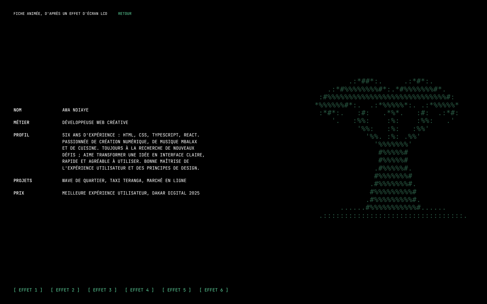
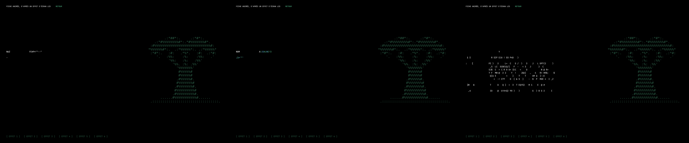

# Modèle 09 — Texte qui se mélange (écran LCD)

| Effet 1 en cours · effet 5 (couleurs) · effet 3 (tirage au hasard) |
|---|
|  |

**Effet de texte** : chaque caractère tire des signes au hasard ou glisse depuis la gauche avant de se fixer, comme un afficheur à cristaux liquides. Six variantes, déclenchables à la demande. Fond noir, capitales à chasse fixe, un seul vert pour les liens, art ASCII en fond.

> Adapté de **Type Shuffle Animation** de Codrops (licence MIT, © 2009-2022 Codrops, [dépôt](https://github.com/codrops/TypeShuffleAnimation)), elle-même inspirée de « LCD 1 ». Les algorithmes et les durées des six effets suivent le code d'origine ; le moteur est réécrit en TypeScript sans dépendance, le contenu et l'art ASCII (un baobab) sont originaux. Voir `THIRD_PARTY_NOTICES.md` à la racine du dépôt.

## Quand le choisir

- Page d'**identité technique** : profil de développeur, page « à propos » d'une agence, écran d'accueil d'un outil en ligne de commande, fiche de projet.
- **Révéler un bloc de texte court** au chargement ou au survol (titre, statut, résultat d'un calcul).

À éviter pour : paragraphes longs que l'on doit lire tout de suite, interfaces administratives (le texte est illisible pendant 1 à 3 s), contenus lus par un lecteur d'écran pendant l'animation (prévoir `aria-live="off"` et le texte final dans le DOM, ce que fait le moteur : il remet toujours l'original).

## Relevé élément par élément (démo d'origine)

| Zone | Éléments |
|---|---|
| Page | fond `#000`, texte blanc en capitales, police à chasse fixe, 18 px de base |
| En-tête | titre de la démo en petit + lien vert « retour » |
| Contenu | liste de définitions : terme gras à gauche (colonne fixe), valeur sur une ou plusieurs lignes à droite (NOM, MÉTIER, BIO, PROJETS, PRIX) |
| Fond | grand portrait en art ASCII, vert sombre, à droite |
| Pied | six boutons texte verts `[ effet N ]` |
| Animation | lancée une fois au chargement (effet 1), puis à chaque clic ; un nouvel effet est refusé tant que le précédent tourne |

## Fichiers

| Fichier | Contenu |
|---|---|
| `exemple.tsx` | `melanger(racine, effet, couleur, fin)` (moteur réutilisable), `LigneLCD` (ligne découpée en caractères), démonstration `TexteLCD` |
| `style.md` | Couleurs, typographie, mise en page |
| `animations.md` | Les six effets : départs, pas, nombre d'itérations |
| `fiche.png`, `effets.png` | Rendu |

## Adapter

- **Réutiliser le moteur** sur n'importe quel bloc : envelopper chaque ligne dans `<LigneLCD texte="…" />`, puis `melanger(conteneur, 1, "#fff")`. Les lignes viennent des données : couper les longs textes à la main (ou par largeur de colonne) pour que l'effet glissant parte bien de la gauche de chaque ligne.
- **Couleurs des effets 5 et 6** : remplacer les trois verts/bleus par trois tons de la marque, dont un très sombre.
- **Art de fond** : un dessin ASCII lié au sujet, en couleur très proche du fond ; il ne doit jamais concurrencer le texte.
- **Mouvement réduit** : la démo n'anime rien si `prefers-reduced-motion` est actif.
