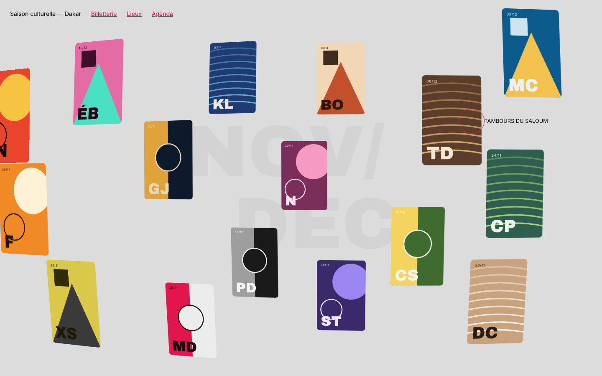
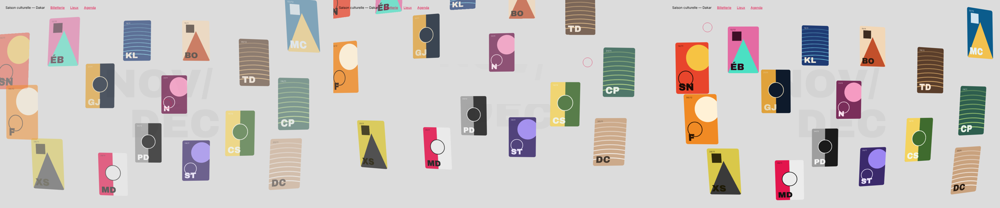
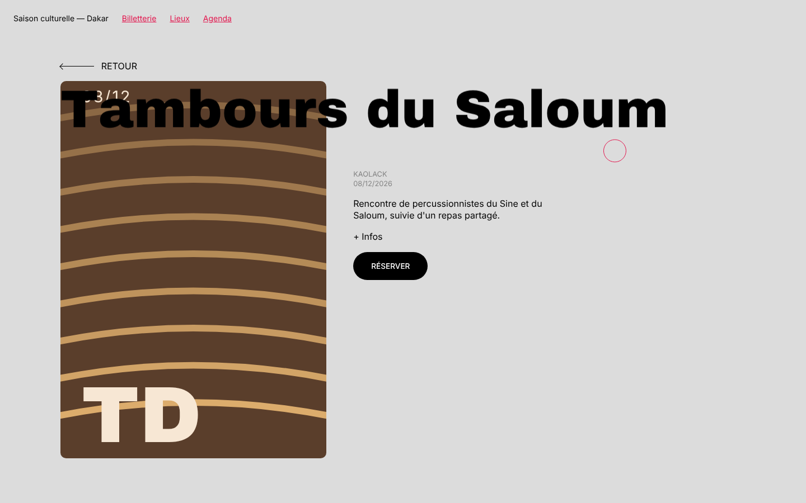

# Modèle 10 — Grille 3D avec aperçu de contenu

| Entrée · vignettes qui s'envolent · retour | Aperçu |
|---|---|
|  |  |

**Galerie en perspective** : seize vignettes éparpillées sur une grille invisible, chacune légèrement tournée vers le centre de l'écran. Elles dérivent à l'inverse de la souris, la vignette survolée est attirée par le curseur et grossit, un cercle rouge suit la souris avec le titre à côté. Au clic, toutes les vignettes s'envolent vers le haut, le grand titre de fond s'efface lettre par lettre et l'aperçu s'ouvre : grande image qui se redresse, titre géant qui monte lettre par lettre, texte et bouton.

> Adapté de **3D Grid Interaction with Content Preview** de Codrops (licence MIT, © 2009-2020 Codrops, [dépôt](https://github.com/codrops/3DGridContentPreview)). Positions, inclinaisons, amortis, courbes et minutages repris du code d'origine (GSAP), réécrits avec `motion` ; contenus et affiches (SVG) originaux. Voir `THIRD_PARTY_NOTICES.md`.

## Quand le choisir

- **Programme d'événements**, portfolio, catalogue de créateurs, sélection de projets : 10 à 20 éléments visuels qu'on parcourt pour le plaisir avant d'en ouvrir un.
- Page d'accueil qui doit **surprendre** dès le premier mouvement de souris.

À éviter pour : listes à trier ou filtrer, plus de 20 éléments, mobile comme cible principale (la parallaxe et le curseur dépendent de la souris ; sur écran tactile, la grille reste fixe et le curseur est masqué).

## Relevé élément par élément (démo d'origine)

| Zone | Éléments |
|---|---|
| Page | fond gris clair `#DCDCDC`, texte noir, liens rouges `#E3154D` soulignés en haut à gauche |
| Titre de fond | deux lignes en capitales grises très pâles (12 vw), la première décalée à gauche, la seconde à droite, derrière la grille |
| Grille | 120 % de l'écran (dépasse de 10 % de chaque côté), 50 × 50 pistes de 2 %, perspective 1 000 px ; 16 vignettes de 5 colonnes × 12 rangées, coins 10 px |
| Inclinaison | selon la position : jusqu'à ±10° autour de l'axe vertical, ±5° autour de l'axe horizontal, profondeur de −200 px (bords) à −600 px (centre) |
| Curseur | cercle de 20 px de rayon, trait rouge 1 px, grossit à ×1,5 sur une vignette ; titre de la vignette à droite du cercle, en retard |
| Aperçu | « ← Retour » en haut à gauche (flèche longue) · grande image à gauche · titre géant noir qui chevauche l'image · à droite : lieu et date en gris, description, « + Infos » rouge, pilule noire « Réserver » |

## Fichiers

| Fichier | Contenu |
|---|---|
| `exemple.tsx` | Grille, boucle d'animation par image, affiches SVG, curseur, aperçu |
| `style.md` | Couleurs, grille, tailles |
| `animations.md` | Parallaxe, magnétisme, entrée, ouverture, fermeture |
| `grille.png`, `sequence.png`, `apercu.png` | Rendu |

## Adapter

- **Images** : remplacer `<Affiche>` par de vraies photos au format portrait 2:3 (fond net, sujet centré) ; garder le coin de 10 px.
- **Positions** : `POSITIONS` donne la rangée et la colonne de départ de chaque vignette ; garder des vides au centre pour que le titre de fond se lise.
- **Titre de fond** : deux mots courts (mois, saison, catégorie), une couleur à peine plus sombre que le fond.
- **Titre de l'aperçu** : sa taille s'adapte au nombre de lettres pour tenir sur une ligne.
- **Accessibilité** : chaque vignette est un lien avec un libellé (titre et date) ; l'aperçu est annoncé (`aria-live`) ; `prefers-reduced-motion` affiche la grille sans entrée animée.
