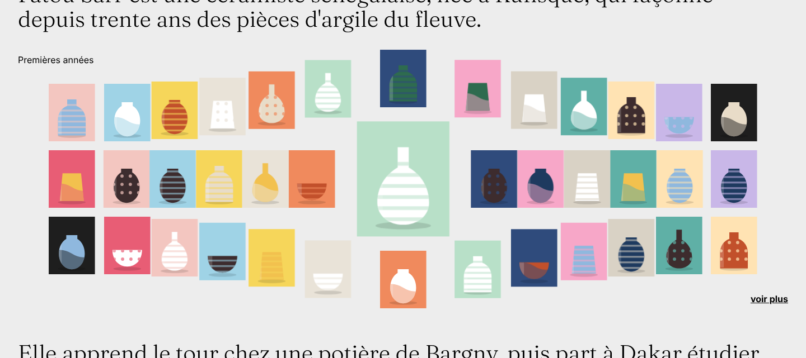
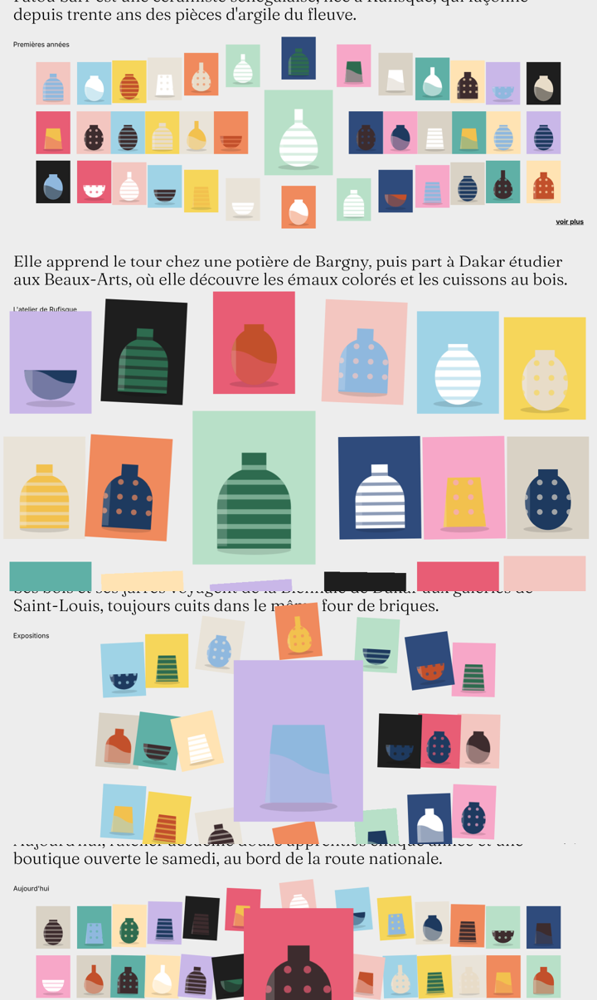

# Modèle 11 — Grille qui s'écarte

**Grille de vignettes où l'élément choisi grandit sur place** et pousse ses voisines : plus une vignette est proche, plus elle s'écarte (et, selon le réglage, plus elle tourne). Un deuxième clic la remet en place ; cliquer une autre vignette fait passer l'agrandissement de l'une à l'autre. Quatre réglages, de l'écart sobre au rebond élastique.

| Les quatre réglages (de haut en bas) |
|---|
|  |

> Adapté de **Make Way Grid Effect** de Codrops (licence MIT, © 2009-2021 Codrops, [dépôt](https://github.com/codrops/MakeWayGridEffect)). Calcul de l'écartement, ordre d'empilement, rotations et les quatre jeux de réglages repris du code d'origine ; courbes GSAP portées en fonctions exactes ; contenu et pièces de céramique (SVG) originaux. Voir `THIRD_PARTY_NOTICES.md`.

## Quand le choisir

- **Planche de miniatures** dans une page éditoriale : œuvres d'un artiste, collection de produits, archives photo, couvertures, échantillons de matières.
- Voir un élément en grand **sans quitter la page** ni ouvrir de fenêtre.

À éviter pour : vignettes qui doivent être lues (texte) même agrandies, grilles cliquables qui mènent ailleurs (le clic sert à agrandir), écrans tactiles étroits (la grille repasse à 4 colonnes).

## Relevé élément par élément (démo d'origine)

| Zone | Éléments |
|---|---|
| Page | fond gris très clair `#EDEDED`, texte noir ; en-tête discret (titre, liens) |
| Section | phrase d'accroche en grand (jusqu'à 2,5 rem, graisse légère, interlignage 1,1) · intertitre en corps normal · grille · lien gras « voir plus » aligné à droite |
| Grille | 92 % de la largeur, écart 1 rem, vignettes au format 1 : 1,25 sans coins arrondis ; 13 colonnes (grilles 1 et 4), 6 colonnes (grille 2), 7 colonnes sur 60 % de largeur (grille 3) |
| Clic | la vignette passe au premier plan et grandit ; les voisines glissent en s'éloignant, empilées de la plus proche (au-dessus) à la plus lointaine |

## Fichiers

| Fichier | Contenu |
|---|---|
| `exemple.tsx` | `GrilleEcartee` (composant réutilisable, réglages en props), `COURBES` (courbes GSAP exactes), `Piece` (céramique SVG), page de démonstration |
| `style.md` | Couleurs, typographie, grilles |
| `animations.md` | Calcul de l'écartement, les quatre réglages, empilement |
| `grille.png`, `variantes.png` | Rendu |

## Adapter

- **Réutiliser** : `<GrilleEcartee colonnes={8} elements={[…]} reglages={{ echelle: 2.5, rotationMax: 6 }} />`.
- **Choisir un réglage** : 1 (sobre) pour une page sérieuse, 2 pour de grandes vignettes, 3 (élastique) pour une marque joueuse, 4 (cisaillement) pour un portfolio graphique.
- **Échelle** : ne pas dépasser ce que la place autour permet ; avec 13 colonnes, ×2 à ×3,2 ; avec 6 colonnes, ×1,5.
- **Images** : un fond par vignette et un sujet centré lisible en petit ; les photos produit sur fond uni marchent le mieux.
- **Accessibilité** : chaque vignette est un bouton avec un libellé ; ajouter au besoin `aria-pressed` pour l'état agrandi.
