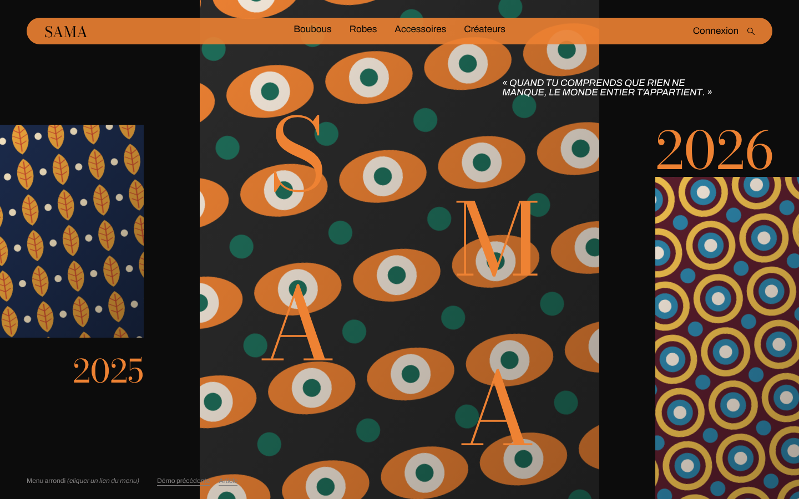
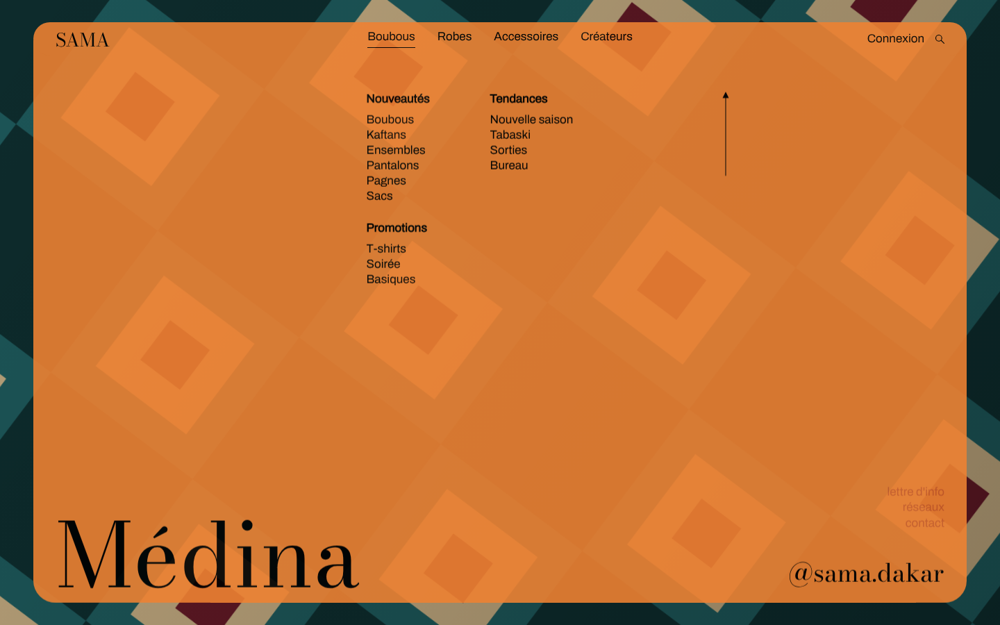
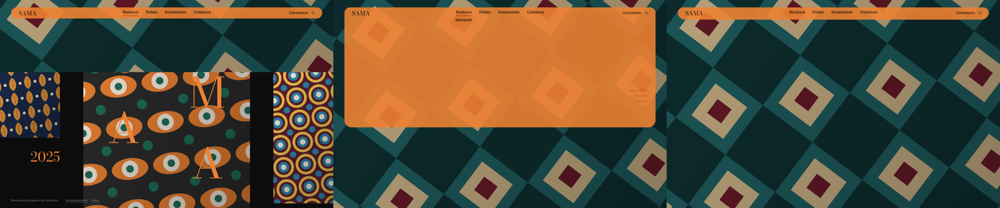

# Modèle 12 — Menu arrondi qui s'ouvre

| Fermé | Ouvert |
|---|---|
|  |  |

| Ouverture à 0,45 s · 0,9 s · fermeture à 0,8 s |
|---|
|  |

**Menu de site vitrine** : une barre orange en pilule flotte au-dessus d'une page éditoriale (trois visuels, grandes lettres en serif, années, citation). Un clic sur n'importe quel lien du menu **découvre une image plein écran** (deux couches qui glissent en sens contraire), décale les visuels de fond, puis le **panneau orange descend** sous la barre, avec ses colonnes de liens, une flèche de retour très longue et un grand mot en serif. La fermeture rejoue la séquence à l'envers.

> Adapté de **Expanding Rounded Menu** de Codrops (licence MIT, © 2009-2021 Codrops, [dépôt](https://github.com/codrops/ExpandingRoundedMenu)). Mise en page, couleurs, durées, départs et courbes repris du code d'origine (GSAP), réécrits avec `motion` ; photos remplacées par des motifs de **tissu wax** dessinés en SVG ; contenus originaux. Voir `THIRD_PARTY_NOTICES.md`.

## Quand le choisir

- **Boutique de mode, marque, magazine, agence** : un site où la navigation doit être un moment de mise en scène, pas une simple liste.
- Menu riche (plusieurs rubriques avec sous-liens) qu'on veut afficher en grand sans quitter la page.

À éviter pour : outils et tableaux de bord (1,6 s d'ouverture, c'est trop pour une navigation fréquente), sites où le menu est ouvert en permanence.

## Relevé élément par élément (démo d'origine)

| Zone | Éléments |
|---|---|
| Page | fond presque noir `#0C0C0C` ; grille de 4 colonnes (18 % / 1fr / 1fr / 18 %, écart 7 vw) et 6 rangées |
| Visuels | à gauche (moyen), au centre (grand, toute la hauteur), à droite (moyen) |
| Titres | quatre lettres géantes (20 vh) en serif orange sur le visuel central, en quinconce sur deux colonnes · année à gauche (4 vw) · année à droite (6,5 vw) |
| Citation | en capitales italiques, en haut à droite, 400 px de large au plus |
| Barre de menu | pilule orange `#EE8233` (coins 2 rem, 3 rem de haut, opacité 0,9), en retrait de 2 rem / 3 rem : marque en serif à gauche, 4 liens au centre, « Connexion » et loupe à droite ; liens soulignés au survol par un trait qui part de la droite |
| Panneau | même orange, coins du bas arrondis, glisse sous la barre : deux colonnes de rubriques (titre gras + liens), **flèche de retour** verticale de 200 px (monte de 10 px au survol), trois liens rouille et un pseudonyme en serif en bas à droite, **mot géant** en serif en bas à gauche |
| Couverture | image plein écran qui se découvre derrière le panneau |

## Fichiers

| Fichier | Contenu |
|---|---|
| `exemple.tsx` | Page, menu, séquence (`SEQUENCE` + `jouer(racine, envers)`), tissus wax (`TissuWax`) |
| `style.md` | Couleurs, typographies, grilles du contenu et du menu |
| `animations.md` | La séquence pas à pas et sa lecture inversée |
| `ferme.png`, `ouvert.png`, `sequence.png` | Rendu |

## Adapter

- **Couleur du menu** : une seule couleur franche ; l'image de couverture doit être **sombre ou neutre** pour que le panneau s'en détache (d'où la couverture wax en tons sombres).
- **Visuels** : remplacer `TissuWax` par des photos (portrait au centre, deux plans plus serrés sur les côtés) ; garder `overflow: hidden` sur chaque cadre, les images se décalent de ±20 %.
- **Lettres du centre** : quatre lettres (nom court de la marque), disposées en quinconce.
- **Séquence** : tout est dans `SEQUENCE` ; changer une durée ou un départ suffit, la fermeture suit (départs miroirs, courbes retournées).
- **Accessibilité** : la flèche de retour a un libellé « Fermer le menu » ; ajouter la fermeture par Échap et le piège de focus si le menu sert en production.
