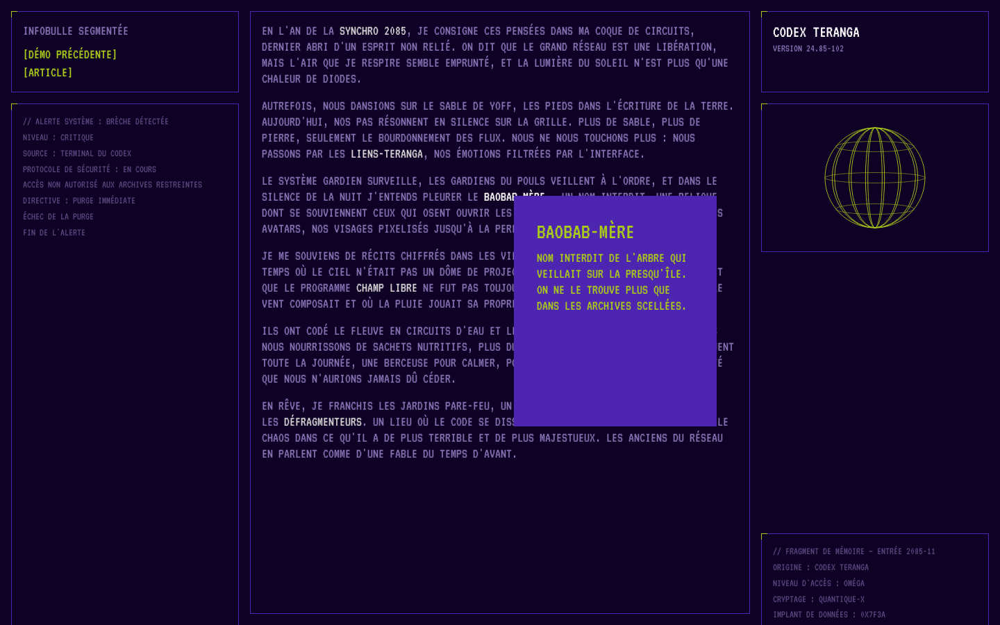
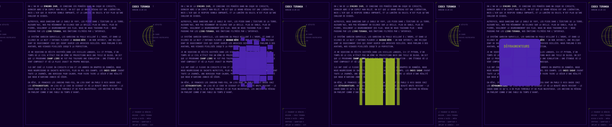

# Modèle 13 — Infobulle en pixels

| Effets 1 (onde depuis le pointeur) · 3 (chute depuis le centre) · 4 (bandes au hasard) · 6 (gluant), en cours d'apparition |
|---|
|  |

**Infobulle dont le fond est une grille de cellules** qui apparaissent l'une après l'autre ; une fois le fond formé, le titre puis le texte s'affichent et **grésillent** brièvement. Six effets, une grille propre à chaque infobulle (de 1 × 14 à 12 × 10 cellules), deux jeux de couleurs. Le tout dans une page de **terminal** violet et vert : texte en police pixel, panneaux à liseré avec coin vert, journaux système, globe filaire.

> Adapté de **Pixel Gooey Tooltip** (« Segmented Tooltip Animation ») de Codrops (licence MIT, © 2009-2022 Codrops, [dépôt](https://github.com/codrops/PixelGooeyTooltip)). Les six effets (délais, échelles, déplacements, ordre), les grilles, le filtre « gluant », le placement au pointeur et l'animation de grésillement suivent le code d'origine (GSAP), réécrits avec `motion` ; le texte (journal de Dakar en 2085), le cadre et le globe sont originaux. Voir `THIRD_PARTY_NOTICES.md`.

## Quand le choisir

- **Glossaire dans un texte** : termes techniques, noms propres, données d'un rapport, définitions dans une documentation ou un récit interactif.
- Interface à l'esthétique **terminal, rétro ou science-fiction** (jeu, événement technologique, page de lancement).

À éviter pour : infobulles d'aide sur des formulaires (trop lent, 0,4 à 2 s avant le texte), interfaces sobres, contenus dont la lecture ne doit jamais attendre.

## Relevé élément par élément (démo d'origine)

| Zone | Éléments |
|---|---|
| Page | fond violet nuit `#0F0026`, texte lavande `#8572B2` en capitales, police pixel ; grille de 3 colonnes (1fr / 50 vw / 1fr) et 3 rangées |
| Panneaux | liseré violet `#4D25B0`, petit coin vert `#ABCB1A` en haut à gauche ; cadre (titre + liens verts entre crochets), texte au centre, deux journaux système en petit (`#58487E`), globe filaire vert, encart « version » |
| Déclencheurs | mots en gris clair `#D2D2D2` dans le texte, non sélectionnables, pointeur main |
| Infobulle | 290 × 330 px (200 × 250 sur mobile) ; fond en cellules violettes (ou vert anis pour la variante) ; titre 2 rem et texte en vert anis (ou gris foncé) ; marge 2 rem ; texte collé en bas |
| Grésillement | les panneaux des journaux et les textes de l'infobulle se décalent et se découpent en bandes pendant 0,4 s toutes les 4 s |

## Fichiers

| Fichier | Contenu |
|---|---|
| `exemple.tsx` | `Declencheur` (mot + infobulle, réutilisable), `Infobulle`, les six effets, filtre « gluant », page de démonstration |
| `style.md` | Couleurs, typographie, grille de la page, infobulle |
| `animations.md` | Les six effets, l'apparition du texte, le grésillement |
| `infobulle.png`, `effets.png` | Rendu |

## Adapter

- **Réutiliser** : `<Declencheur d={{ titre, texte, rangs: 8, cols: 6, effet: 3 }} idFiltre="…">mot</Declencheur>` ; le filtre SVG `gluant` doit être présent une fois dans la page pour l'effet 6.
- **Grille** : beaucoup de petites cellules (12 × 10) pour les effets 1 et 5, des bandes (1 × 14) pour l'effet 4, peu de grosses cellules (5 × 3) pour l'effet 6.
- **Couleurs** : un fond franc et un texte très contrasté ; garder la page sombre pour que l'infobulle claque.
- **Accessibilité** : `role="tooltip"`, ouverture aussi au clavier (focus) ; le texte de l'infobulle est dans le DOM dès le départ ; `prefers-reduced-motion` coupe le grésillement et le globe.
